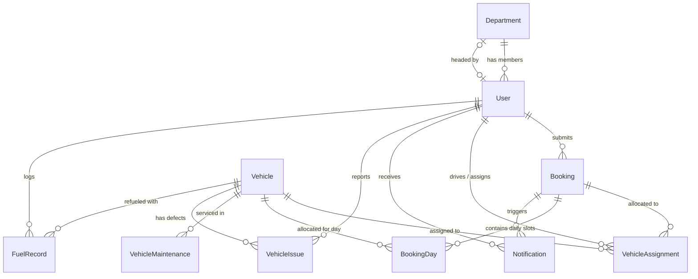

# Capital Fleet — Database Architecture & Data Model Guide

**Database Management System:** PostgreSQL 16 (Alpine container)  
**ORM Client:** Prisma 5.11.0  
**Schema Path:** `prisma/schema.prisma`  
**Document Version:** 2.0  

---

## 1. Database Architecture Overview

Capital Fleet utilizes PostgreSQL 16 as its relational database. The schema is defined exclusively in `prisma/schema.prisma` and compiled into the type-safe `@prisma/client` library.

### Key Architectural Characteristics:
- **ACID Compliance:** Transactions protect multi-table writes (e.g., booking creation alongside recurring `BookingDay` slots).
- **Referential Integrity:** Foreign keys enforce valid cross-table references (`onDelete: Cascade` or `onDelete: SetNull`).
- **High-Performance Indexing:** B-Tree indexes speed up availability lookups, status filtering, and foreign key traversals.
- **Enumerations:** Prisma enums guarantee that status fields only hold valid domain values.

---

## 2. Entity-Relationship Overview

---

## 3. Relational Table Specifications

### 1. `departments` (`Department`)
| Column | Type | Constraints | Description |
| :--- | :--- | :--- | :--- |
| `id` | UUID | PK, default `uuid()` | Department primary identifier. |
| `name` | String | UNIQUE | Department name (e.g. "Civil Engineering"). |
| `code` | String | UNIQUE, Optional | Short code (e.g. "ENG"). |
| `headId` | UUID | FK -> `users.id` | Optional department head. |
| `isActive` | Boolean | Default `true` | Soft active status. |

### 2. `users` (`User`)
| Column | Type | Constraints | Description |
| :--- | :--- | :--- | :--- |
| `id` | UUID | PK, default `uuid()` | Staff account identifier. |
| `employeeId` | String | UNIQUE, Optional | Enterprise employee number (e.g. "EMP-001"). |
| `name` | String | Required | Full staff name. |
| `email` | String | UNIQUE | Authentication email. |
| `passwordHash` | String | Required | 60-character bcrypt hash (never plaintext). |
| `role` | UserRole | Enum: `EMPLOYEE`, `DRIVER`, `LOGISTICS_ADMIN`, `SYSTEM_ADMIN` | RBAC authorization role. |
| `departmentId`| UUID | FK -> `departments.id` | Optional department assignment. |
| `licenseNumber`| String| Optional | Driver license number (required for chauffeurs). |
| `isActive` | Boolean | Default `true` | Account active flag. |

### 3. `vehicles` (`Vehicle`)
| Column | Type | Constraints | Description |
| :--- | :--- | :--- | :--- |
| `id` | UUID | PK, default `uuid()` | Vehicle primary identifier. |
| `name` | String | Required | Display name (e.g. "Toyota Land Cruiser"). |
| `registrationNumber` | String | UNIQUE | License plate number (e.g. "AA-3-A12345"). |
| `category` | VehicleCategory | Enum: `SEDAN`, `SUV`, `PICKUP`, `MINIBUS`, `OTHER` | Vehicle form factor. |
| `passengerCapacity` | Int | Default `4` | Maximum passenger seating capacity. |
| `operationalStatus` | VehicleOperationalStatus | Enum: `ACTIVE`, `MAINTENANCE`, `OUT_OF_SERVICE`, `INACTIVE` | Fleet readiness state. |
| `mileage` | Float | Default `0` | Cumulative odometer mileage in kilometers. |
| `fuelLevel` | Int | Default `85` | Approximate percentage (0-100%). |
| `hasSafetyAlert` | Boolean | Default `false` | True if unresolved critical defect exists. |

### 4. `bookings` (`Booking`)
| Column | Type | Constraints | Description |
| :--- | :--- | :--- | :--- |
| `id` | UUID | PK, default `uuid()` | Booking primary identifier. |
| `bookingReference` | String | UNIQUE | Human-readable code (e.g. "BK-202611-001"). |
| `requesterId` | UUID | FK -> `users.id` | Staff member requesting transport. |
| `destination` | String | Required | Target travel destination. |
| `purpose` | String | Required | Official business justification. |
| `departureAt` | DateTime | Required | Scheduled departure date & time. |
| `expectedReturnAt` | DateTime | Required | Scheduled return date & time. |
| `actualDepartureAt` | DateTime | Optional | Timestamp when trip actually started. |
| `actualReturnAt` | DateTime | Optional | Timestamp when trip was completed. |
| `startOdometer` | Float | Optional | Starting odometer reading (km). |
| `endOdometer` | Float | Optional | Return odometer reading (km). |
| `passengerCount` | Int | Default `1` | Number of staff members traveling. |
| `requiresDriver` | Boolean | Default `false` | True if dedicated chauffeur requested. |
| `status` | BookingStatus | Enum: `PENDING_APPROVAL`, `APPROVED`, `REJECTED`, `ASSIGNED`, `IN_PROGRESS`, `COMPLETED`, `CANCELLED` | Lifecycle state. |
| `verificationToken` | String | UNIQUE, Optional | Cryptographic UUID for gate QR verification. |

### 5. `vehicle_assignments` (`VehicleAssignment`)
| Column | Type | Constraints | Description |
| :--- | :--- | :--- | :--- |
| `id` | UUID | PK, default `uuid()` | Assignment primary identifier. |
| `bookingId` | UUID | FK -> `bookings.id` (Cascade) | Transport booking allocation. |
| `vehicleId` | UUID | FK -> `vehicles.id` | Physical vehicle asset allocated. |
| `driverId` | UUID | FK -> `users.id` (Optional) | Chauffeur assigned. |
| `assignedById` | UUID | FK -> `users.id` | Logistics officer who made assignment. |
| `status` | String | Default `PENDING_CONFIRMATION` | `PENDING_CONFIRMATION`, `CONFIRMED`, `DECLINED`. |

---

## 4. Indexing & Query Optimization Strategy

The schema applies indexes tailored to high-frequency query filters:
1. `bookings`:
   - `@@index([status])`: Speeds up dashboard queue queries (`status = 'PENDING_APPROVAL'`).
   - `@@index([requesterId])`: Optimizes employee booking history.
   - `@@index([departureAt, expectedReturnAt])`: Speeds up date-range overlap scans.
2. `vehicles`:
   - `@@index([operationalStatus])`: Filters available vehicles for auto-assignment.
   - `@@index([registrationNumber])`: Fast vehicle plate lookup.
3. `vehicle_assignments`:
   - `@@index([vehicleId, assignedAt, unassignedAt])`: Critical for detecting double-booking collisions.
   - `@@index([driverId])`: Speeds up chauffeur daily trip queries.
4. `audit_logs`:
   - `@@index([entityType, entityId])`: Fast entity change history retrieval.
   - `@@index([actorId])`: Fast user audit lookups.

