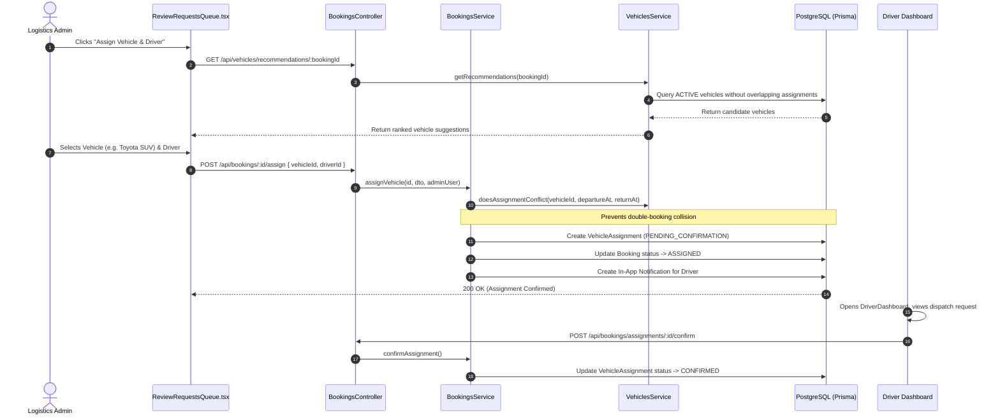

# Capital Fleet — Project Execution Flow & Request Lifecycle

**Purpose:** Comprehensive guide explaining how data and requests travel end-to-end through the **Capital Fleet Management System**, tracing user interactions in the browser through network proxies, NestJS middleware, validation pipes, controllers, services, Prisma ORM, and PostgreSQL.

---

## 1. High-Level End-to-End Architectural Flow

```
[ Browser / User ]
       │
       ▼ (1) User interaction in React component (e.g. clicks "Submit Request")
[ React Form State & Client Validation ]
       │
       ▼ (2) Asynchronous API Call: api.createBooking(payload)
[ ApiClient (apps/web/src/lib/api.ts) ]
       │
       ▼ (3) HTTP POST /api/bookings with `Authorization: Bearer <JWT>`
[ Vite Dev Proxy / Web Server ] (Forwards /api to :4100)
       │
       ▼ (4) Express Middleware: Security headers & JSON body parser (10MB)
[ NestJS Application Bootstrap (main.ts) ]
       │
       ▼ (5) Global Guards & Interceptors:
       │     - JwtAuthGuard: verifies token signature & extracts user payload
       │     - RolesGuard: verifies user role permissions (@Roles)
       ▼ (6) Global ValidationPipe:
       │     - class-validator: validates CreateBookingDto constraints
       ▼ (7) Controller Dispatch:
       │     - BookingsController.create(@CurrentUser() user, @Body() dto)
       ▼ (8) Service Business Logic:
       │     - BookingsService.create()
       │     - Enforces advance notice rules from SettingsService
       │     - Validates departure/return datetime constraints
       │     - Checks duplicate requests within time window
       ▼ (9) Database Persistence:
       │     - PrismaService.booking.create()
       │     - Prisma Client compiles SQL and sends to PostgreSQL 16
       ▼ (10) Event Side-Effects:
       │     - AuditService.log(): writes immutable audit record
       │     - NotificationsService.create(): notifies logistics officers
       ▼ (11) HTTP Response:
       │     - 201 Created with JSON booking payload returned to browser
       ▼ (12) React State Update:
             - Closes modal, updates `bookings` state, triggers Toast notification
```

---

## 2. Detailed Lifecycle: Transport Booking Request Flow

### Step 1: User Submission in Frontend
1. The employee fills out `BookingRequestForm.tsx`.
2. Form fields include:
   - `destination`, `purpose`, `departureAt`, `expectedReturnAt`, `passengerCount`, `priority`, `requiresDriver`, and optional weekly days.
3. The component performs initial client-side verification (e.g. `expectedReturnAt > departureAt`).
4. On submit, `api.createBooking(payload)` is invoked.

### Step 2: HTTP Transport & Network Authentication
1. `ApiClient.request()` attaches `Authorization: Bearer <token>` from `sessionStorage`.
2. A `POST /api/bookings` request is transmitted over HTTP.
3. In development, Vite's proxy forwards the request to `http://localhost:4100/api/bookings`.

### Step 3: NestJS Pipeline & Security Verification
1. **Security Headers Middleware:** Adds `X-Frame-Options: DENY`, `X-Content-Type-Options: nosniff`.
2. **`JwtAuthGuard`:**
   - Extracts the Bearer token.
   - Validates the cryptographic HMAC-SHA256 signature against `JWT_SECRET`.
   - Attaches `{ id, email, role }` to `req.user`.
3. **`RolesGuard`:** Verifies that the endpoint allows role `EMPLOYEE`.
4. **`ValidationPipe`:**
   - Transforms JSON into an instance of `CreateBookingDto`.
   - Validates string formats, ISO 8601 timestamps, and positive passenger counts.

### Step 4: Business Rules in `BookingsService.create()`
1. **Notice Period Check:**
   - Queries `SettingsService.get('minimumNoticeHours')` (e.g. 24 hours).
   - Validates that `departureAt >= now + minimumNoticeHours`.
   - Throws `BadRequestException` if insufficient advance notice is provided.
2. **Duplicate Detection:**
   - Queries existing active bookings for the same requester with overlapping departure/return intervals.
   - Throws `BadRequestException` if a conflicting trip is detected.
3. **Reference Generation:**
   - Generates human-readable reference: `BK-YYYYMM-<uuid-prefix>`.
4. **Token Generation:**
   - Generates cryptographic `verificationToken` for gate QR code validation.

### Step 5: Database Commit & Asynchronous Side-Effects
1. `prisma.booking.create()` persists the record with status `PENDING_APPROVAL`.
2. If `requestType === 'WEEKLY'`, child `BookingDay` records are created in a single transaction.
3. `AuditService` logs: `CREATE_BOOKING`.
4. `NotificationsService` dispatches alert to all users with `role: LOGISTICS_ADMIN`.

---

## 3. Detailed Lifecycle: Logistics Review & Assignment Flow



---

## 4. Detailed Lifecycle: Trip Execution & Gate Verification Flow

### 1. Trip Commencement (Departure)
1. Chauffeur or Logistics Officer opens `TripExecutionModal.tsx`.
2. Enters verified starting odometer (e.g. `25,400 km`) and clicks "Start Trip".
3. Request hits `POST /api/bookings/:id/start-trip`.
4. `BookingsService.startTrip()`:
   - Validates booking is in `ASSIGNED` state.
   - Saves `startOdometer` and `actualDepartureAt = new Date()`.
   - Transitions booking status to `IN_PROGRESS`.
   - Updates vehicle status to `ACTIVE` (in transit).

### 2. Destination Arrival & Delay Management
1. Upon reaching the project site, the driver marks arrival: `POST /api/bookings/:id/mark-arrival`.
2. If traffic delays occur, driver posts: `POST /api/bookings/:id/report-delay` with reason.
3. Notifications are dispatched to the requester employee.

### 3. Trip Completion & Return Odometer Delta
1. Upon return to headquarters, driver enters end odometer (e.g. `25,480 km`).
2. Request hits `POST /api/bookings/:id/complete-trip`.
3. `BookingsService.completeTrip()`:
   - Enforces `endOdometer >= startOdometer`.
   - Computes distance traveled: $\Delta \text{km} = \text{endOdometer} - \text{startOdometer} = 80 \text{ km}$.
   - Updates vehicle cumulative mileage: `vehicle.mileage += 80`.
   - Sets status to `COMPLETED`.
   - Frees vehicle and driver for subsequent assignments.

### 4. Public QR Code Gate Verification
1. Digital or printed receipt contains QR code: `http://localhost:5173/?verify=<token>`.
2. Gate security scans QR code with mobile smartphone.
3. Browser opens `PublicVerificationPage.tsx` without requiring login.
4. Calls `@Public()` endpoint `GET /api/bookings/verify-token/:token`.
5. Screen displays:
   - Vehicle plate number (`AA-3-A12345`).
   - Assigned driver name and phone.
   - Requester department and destination.
   - Status badge: `VERIFIED VALID PASS` (green) or `EXPIRED / INVALID` (red).
