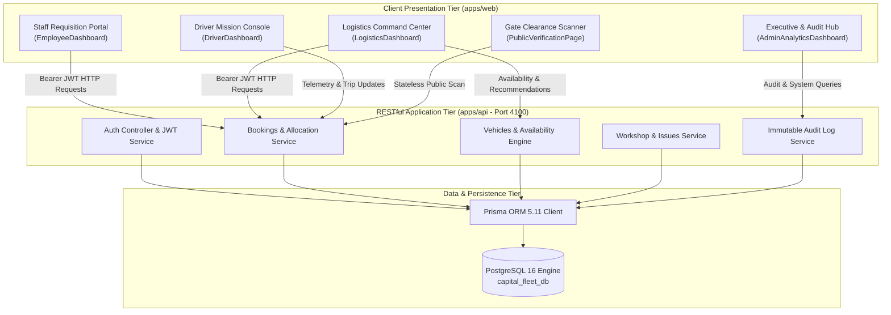

# Capital Fleet Management System
## Deliverable 01: Project Overview & System Context

**Document ID:** `DOC-01`  
**Classification:** Academic & Technical System Specification  
**Status:** **Verified** against active repository codebase  

---

## 1. Project Identity & Organizational Background

The **Capital Real Estate Fleet Management System** (internal project codename: *Capital Fleet*) is an enterprise transportation coordination platform designed specifically for **Capital Real Estate**, a leading real estate development and civil engineering firm operating in Addis Ababa, Ethiopia.

### 1.1 Organizational Setting
Capital Real Estate manages large-scale property developments across multiple metropolitan zones, including Bole Tower (Corporate Headquarters), CMC Real Estate Development, Ayat Zone C Residential Construction, Lebu Mixed-Use Commercial Site, and Kazanchis Liaison Facilities. To maintain operational rhythm, project managers, site engineers, quantity surveyors, architects, executive directors, and legal liaison teams require daily, inter-site ground transportation.

---

## 2. Problem Statement & Operational Rationale

Prior to the deployment of this web-based system, Capital Real Estate managed fleet logistics through decentralized, manual channels:

```
[Legacy Operational Chaos]
Staff Phone Calls / Telegram Messages / Paper Slips
           │
           ▼
Uncoordinated Dispatches ──> Vehicle Double-Booking
           │
           ├──> Unapproved Personal Travel & Fuel Waste
           │
           ├──> Security Checkpoint Delays (No Verifiable Clearance)
           │
           └──> Chauffeurs Unable to Log Odometer & Mechanical Issues
```

### 2.1 Concrete Operational Failures Identified:
1. **Pervasive Double-Booking:** Transport officers maintained individual paper calendars, causing multiple departments to be promised the same utility pickup or sedan simultaneously.
2. **Unauthorized Mileage & Fuel Depletion:** Employees frequently commandeered company vehicles directly from drivers without departmental approval or management oversight.
3. **Dispatch Gate Vulnerability:** Company security personnel at the corporate compound gates had no mechanism to verify whether an outbound vehicle had legitimate authorization.
4. **Unrecorded Odometer Readings & Maintenance Blindness:** Drivers had no mobile mechanism to log departure and return mileage or report emerging defects, causing missed maintenance intervals.
5. **Lack of Auditability:** Operational disputes could not be resolved due to the total absence of immutable logs detailing who requested, approved, or assigned trips.

---

## 3. System Objectives

### 3.1 Primary Objective
To design and deploy a centralized, role-based single-page web application (SPA) that unifies transportation request submission, departmental review, intelligent fleet allocation, chauffeur telemetry tracking, and digital gate pass verification.

### 3.2 Specific Functional Objectives
- **Self-Service Requisitions:** Provide staff with intuitive forms for both single-day and recurring weekly bookings.
- **Strict Approval Gate:** Enforce departmental authorization prior to fleet allocation, barring allocation on unapproved requests.
- **Conflict-Free Asset Allocation:** Implement real-time scheduling conflict detection and 1-Click Smart Auto-Assign algorithms.
- **Mobile Chauffeur Cockpit:** Equip chauffeurs with a dedicated mobile interface for mission confirmation, odometer recording, and delay logging.
- **Cryptographic Gate Passes:** Enable dynamic QR-code digital receipts and printable requisition vouchers with gate security verification.

---

## 4. Frontend Responsibilities vs. Backend Boundaries

The system architecture cleanly delineates client-side user experience from authoritative server-side business rules:

| Operational Area | Frontend Responsibility (`apps/web`) | Backend Responsibility (`apps/api`) |
|:---|:---|:---|
| **Requisition Intake** | Input collection, date validation (departure < return), passenger count, UI notice policy enforcement (24h/72h). | Database persistence, booking reference generation (`CR-2026-xxxx`), relational foreign key validation. |
| **Approval Workflow** | Queue presentation, one-click approve trigger, modal prompt for mandatory rejection justification. | Actor authorization check, state transition validation, audit log persistence (`auditLog.create`). |
| **Fleet Allocation** | Display recommendation cards, passenger capacity checks, conflict badges, driver selection. | **Authoritative row-level locks** (`SELECT ... FOR UPDATE`), transaction-safe conflict prevention, overlap detection. |
| **Trip Telemetry** | Chauffeur input forms for start/complete odometers, transit delay notes, checkpoint arrival triggers. | Trip status transition (`IN_PROGRESS` -> `COMPLETED`), assignment closure, odometer delta computation. |
| **Gate Clearance** | SVG/Canvas QR rendering (`qrcode`), printable voucher formatting (`@media print`), public pass display. | Cryptographic verification token generation, stateless token decoding, gate security validation. |
| **Security & RBAC** | Dynamic sidebar navigation filtering, user profile storage in `sessionStorage`. | **Authoritative JWT authentication** (`JwtAuthGuard`), role-based endpoint protection (`RolesGuard`). |

---

## 5. High-Level System Architecture Diagram



---

## 6. Verified User Personas & Permissions

The frontend implements four distinct operational roles (verified in [`apps/web/src/types/index.ts`](file:///home/yeabsira-hailegiorgis/Documents/Capital%20Fleet/apps/web/src/types/index.ts#L4-L10)):

```
┌─────────────────┬──────────────────────┬────────────────────────────────────────────────────────┐
│ Role            │ Primary Interface    │ Key Responsibilities & Capabilities                    │
├─────────────────┼──────────────────────┼────────────────────────────────────────────────────────┤
│ EMPLOYEE        │ EmployeeDashboard    │ Submit single/weekly requests; track status; view receipts │
│ LOGISTICS_ADMIN │ LogisticsDashboard   │ Review queues; approve/reject; assign vehicles & drivers   │
│ DRIVER          │ DriverDashboard      │ View assigned trips; confirm missions; log odometers   │
│ SYSTEM_ADMIN    │ AdminAnalyticsDash   │ Manage fleet assets, users, departments; inspect audit logs│
└─────────────────┴──────────────────────┴────────────────────────────────────────────────────────┘
```

---

## 7. Verified Limitations & Out-of-Scope Items

To preserve strict technical accuracy for academic reporting, the following operational limitations are documented:
1. **Cellular SMS Gateway:** Physical SMS delivery to driver handsets is **unverified** without active GSM modem hardware or telecom aggregator credentials. The application safely routes all alerts to the persistent in-app notification center.
2. **Live GPS Telematics:** Vehicle location tracking is currently handled through chauffeur checkpoint arrival reports rather than automated on-board OBD-II hardware GPS streams.
3. **Client-Side Unit Tests:** While backend unit tests and monorepo E2E tests are complete, `apps/web/package.json` currently lacks a Vitest or Jest runner for isolated React component tests.
