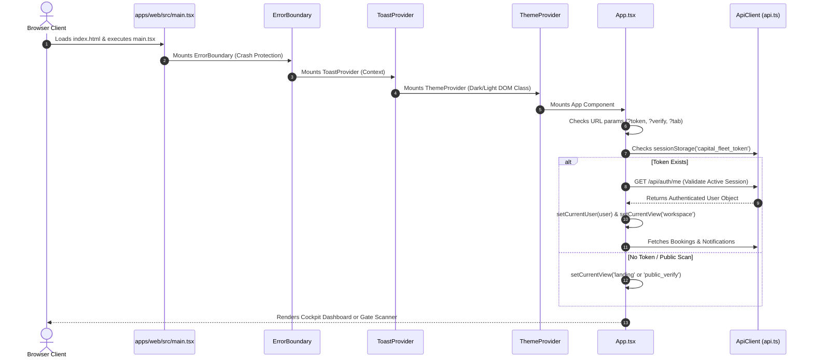
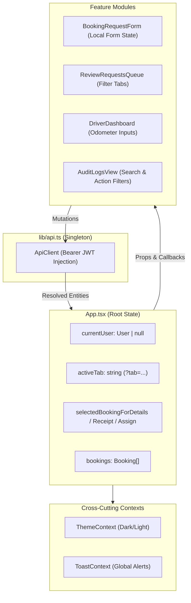

# Capital Fleet Management System
## Deliverable 04: Frontend Architecture & Design Patterns

**Document ID:** `DOC-04`  
**Classification:** Software Architecture & Structural Design Document  
**Status:** **Verified** against active React implementation  

---

## 1. Architectural Style & Composition

The Capital Fleet frontend is built as a **Component-Based Single Page Application (SPA)** using React 18 and TypeScript. The application does not follow a strict backend pattern like Clean Architecture or MVVM; rather, it implements a pragmatic **Feature-Sliced Container/Presenter Architecture** organized around domain workflows:

```
┌────────────────────────────────────────────────────────┐
│                   App (Root Shell)                     │
│         Manages Session, View State & Active Tab       │
└───────────────────────────┬────────────────────────────┘
                            │
              ┌─────────────┴─────────────┐
              ▼                           ▼
      AppShell (Layout)         Public Views (Unauthenticated)
    ┌─────────┴─────────┐         - LandingPage
    │                   │         - LoginPage
Sidebar (Nav)       Navbar (Status) - PublicVerificationPage
    │                   │
    └─────────┬─────────┘
              ▼
    Active Feature Container
    - EmployeeDashboard / BookingRequestForm
    - LogisticsDashboard / ReviewRequestsQueue
    - DriverDashboard / TripExecutionModal
    - AdminAnalyticsDashboard / AuditLogsView
```

---

## 2. Application Bootstrap Pipeline

The startup sequence from browser load to rendered DOM is traced below:



---

## 3. Component Composition Hierarchy

The application organizes UI elements into clear hierarchical levels:

1. **Top-Level Root Containers:**
   - [`App.tsx`](file:///home/yeabsira-hailegiorgis/Documents/Capital%20Fleet/apps/web/src/App.tsx): Coordinates global state, active tabs, and modals.
   - [`AppShell.tsx`](file:///home/yeabsira-hailegiorgis/Documents/Capital%20Fleet/apps/web/src/components/layout/AppShell.tsx): Manages responsive sidebar drawer and header chrome.
2. **Domain-Specific Feature Views (`src/features/*`):**
   - Encapsulate data fetching, form handling, and user actions for a specific workflow (e.g., `ReviewRequestsQueue`, `AssignVehicleModal`, `DriverDashboard`).
3. **Atomic UI Primitives (`src/components/ui/*`):**
   - Stateless, reusable design primitives (`Button`, `Card`, `Badge`, `Input`, `Modal`, `SmartDropdown`).
4. **Automotive & Telematics Widgets (`src/components/automotive/*`):**
   - Visual progress indicators (`AutomotiveJourneySpine`, `DynamicFleetRouteSimulation`).

---

## 4. State Ownership & Data Flow Architecture

Data flows strictly downward via props and upward via event callbacks, complemented by React Context for cross-cutting concerns:



---

## 5. Architectural Design Patterns Formally Identified

The codebase demonstrates several well-established software engineering patterns:

### 5.1 Singleton Pattern (`ApiClient`)
- **Evidence:** [`apps/web/src/lib/api.ts:494`](file:///home/yeabsira-hailegiorgis/Documents/Capital%20Fleet/apps/web/src/lib/api.ts#L494) exports a single shared instance: `export const api = new ApiClient()`.
- **Purpose:** Centralizes authorization header management, base URL resolution, and network error parsing.

### 5.2 Provider Pattern (`ThemeContext`, `ToastContext`)
- **Evidence:** [`ThemeContext.tsx`](file:///home/yeabsira-hailegiorgis/Documents/Capital%20Fleet/apps/web/src/context/ThemeContext.tsx) and [`Toast.tsx`](file:///home/yeabsira-hailegiorgis/Documents/Capital%20Fleet/apps/web/src/components/ui/Toast.tsx).
- **Purpose:** Avoids prop-drilling for theme toggling and notification banners across deeply nested views.

### 5.3 Compound Component Pattern (`Card`, `Modal`)
- **Evidence:** [`Card.tsx`](file:///home/yeabsira-hailegiorgis/Documents/Capital%20Fleet/apps/web/src/components/ui/Card.tsx) exports `Card`, `CardHeader`, `CardTitle`, `CardContent`, and `CardFooter`.
- **Purpose:** Enables flexible, declarative visual composition while maintaining unified styling rules.

### 5.4 Controlled Component Pattern (Forms)
- **Evidence:** [`BookingRequestForm.tsx`](file:///home/yeabsira-hailegiorgis/Documents/Capital%20Fleet/apps/web/src/features/bookings/BookingRequestForm.tsx#L40-L75).
- **Purpose:** Form inputs bind strictly to React state (`formData.destination`, `formData.departureAt`), validating constraints prior to submission.
