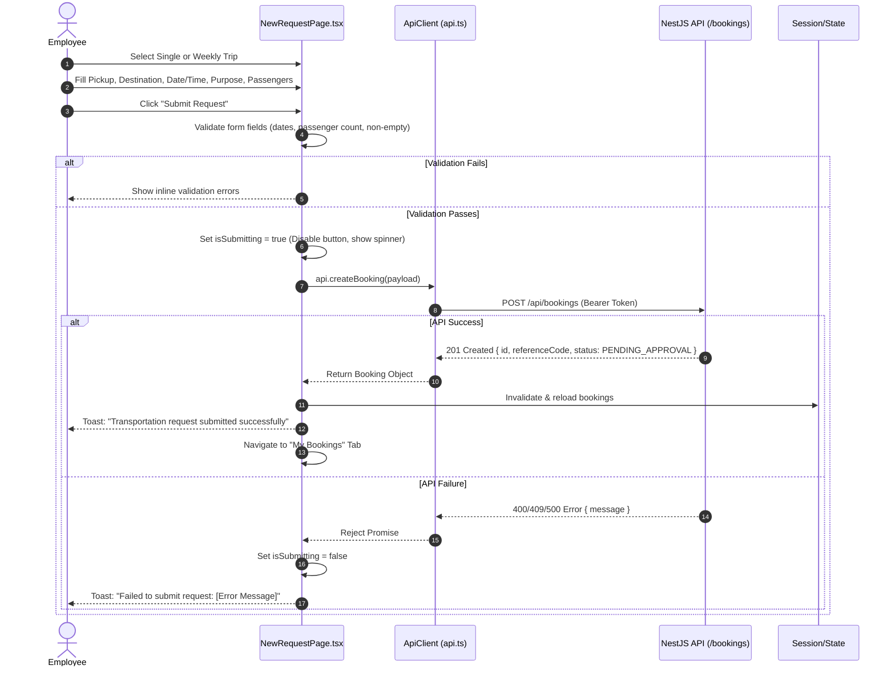
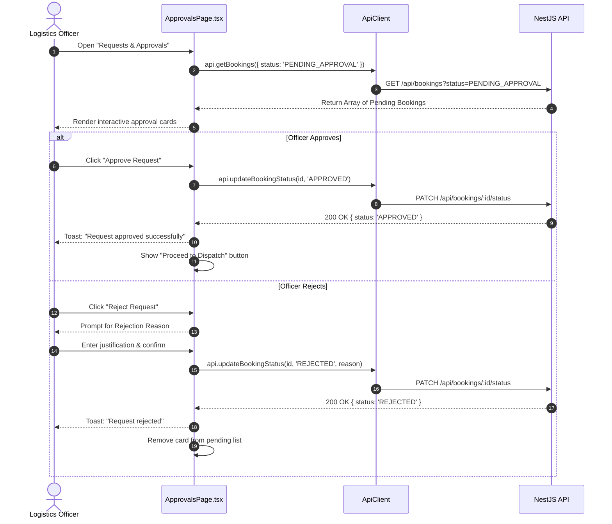
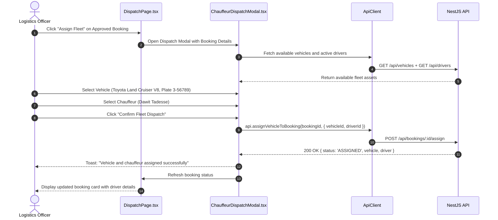

# 07 — User Roles and Frontend User Journeys

This document details the user personas, role permissions, and comprehensive step-by-step user journeys implemented in the **Capital Fleet** frontend application. It specifically maps the verified workflows against the actual source code and components.

---

## 1. User Roles and Permission Matrix

Capital Fleet defines four system roles in [apps/web/src/types/index.ts](file:///home/yeabsira-hailegiorgis/Documents/Capital%20Fleet/apps/web/src/types/index.ts):

| System Role | Primary Responsibilities | Available Frontend Tabs & Navigation |
|---|---|---|
| **`EMPLOYEE`** | Submitting transportation requests, tracking booking status, viewing approved gate passes, reviewing booking history. | Dashboard, New Request, My Bookings, Profile. |
| **`LOGISTICS_ADMIN`** | Reviewing pending employee requests, approving or rejecting requests, dispatching vehicles and drivers, monitoring fleet availability, managing maintenance schedules, generating reports. | Fleet Overview, Requests & Approvals, Dispatch & Assignment, Vehicle Inventory, Driver Directory, Maintenance Logs, Live Telematics, Reports & Analytics, Audit Trail. |
| **`DRIVER`** | Reviewing assigned trips, conducting pre-trip inspections, updating trip status (Start / In Progress / Complete), logging closing mileage. | Chauffeur Portal, Assigned Trips, Trip Log, Vehicle Inspection, Profile. |
| **`SYSTEM_ADMIN`** | Complete governance over organization users, assigning system roles, configuring departments, viewing system audit trail, system settings. | All system tabs + User Management, Department Management, System Settings. |

---

## 2. End-to-End User Journey: Scenario 1 — Employee Creates a Request

### 2.1 Trigger & Entry
1. The employee signs in through [LoginPage.tsx](file:///home/yeabsira-hailegiorgis/Documents/Capital%20Fleet/apps/web/src/pages/LoginPage.tsx).
2. The employee clicks **"New Request"** in the sidebar or navbar, transitioning the app to the `new-request` tab in [NewRequestPage.tsx](file:///home/yeabsira-hailegiorgis/Documents/Capital%20Fleet/apps/web/src/pages/NewRequestPage.tsx).

### 2.2 Input Fields & Form Controls
The request creation form supports two distinct scheduling modes:

1. **Scheduling Mode Selector:**
   - **Single-Day Trip (`SINGLE`):** Employee selects a single date, pickup time, and return time.
   - **Recurring / Weekly Route (`RECURRING`):** Employee selects a date range and checks recurrent weekdays (Monday through Friday) for recurring corporate office commutes.
2. **Time Slot Options:**
   - Supports precise time selection as well as **Morning Period** (e.g., 08:00 AM - 12:00 PM) and **Afternoon Period** (e.g., 01:00 PM - 05:00 PM) corporate commuting windows.
3. **Trip Details:**
   - **Pickup Location:** Text input (defaulting to Capital Real Estate Head Office or designated site).
   - **Destination:** Dropdown / text input of company sites (e.g., Bole Luxury Tower, Gotera Heights, CMC Residential Site, Bole Airport).
   - **Purpose / Business Justification:** Required text area explaining the operational business requirement for the trip.
   - **Passenger Count:** Numeric counter (1 to 25 passengers).
   - **Passenger Manifest / Contact Phone:** Contact phone number for the requesting employee or lead passenger.

### 2.3 Validation & Submission Flow
- **Client-Side Validation:** Form blocks submission and displays inline errors if:
  - Destination or purpose is empty.
  - Pickup date/time is set in the past.
  - Return time precedes pickup time.
  - Passenger count is less than 1.
- **API Call:** Dispatches `POST /api/bookings` with payload `{ pickupLocation, destination, startTime, endTime, purpose, passengerCount, bookingType, recurringDays }`.
- **Success State:** Displays success toast notification ("Transportation request submitted successfully"), generates reference code (e.g., `CR-2026-XXXX`), and redirects the employee to the `bookings` tab.



---

## 3. End-to-End User Journey: Scenario 2 — Logistics Reviews a Request

### 3.1 Review Interface
1. A Logistics Officer navigates to the **"Requests & Approvals"** tab ([ApprovalsPage.tsx](file:///home/yeabsira-hailegiorgis/Documents/Capital%20Fleet/apps/web/src/pages/ApprovalsPage.tsx)).
2. The page loads all pending requests via `GET /api/bookings?status=PENDING_APPROVAL`.
3. Requests are displayed in interactive approval cards showing requesting employee, department badge, date/time, destination, passenger count, and justification.

### 3.2 Decision Actions
- **Approve Action:**
  - Officer clicks **"Approve"**.
  - A confirmation dialog displays summary information.
  - Dispatches `PATCH /api/bookings/:id/status` with `{ status: 'APPROVED' }`.
  - On success, booking status transitions to `APPROVED`, an audit log entry is written, and the card offers a direct shortcut: **"Proceed to Dispatch"**.
- **Reject Action:**
  - Officer clicks **"Reject"**.
  - A modal opens requiring a mandatory rejection reason (e.g., "No available vehicle in required passenger class", "Personal errands not permitted under corporate vehicle policy").
  - Dispatches `PATCH /api/bookings/:id/status` with `{ status: 'REJECTED', rejectionReason: string }`.
  - On success, the booking is marked rejected and removed from the active pending queue.



---

## 4. End-to-End User Journey: Scenario 3 — Vehicle and Driver Assignment

### 4.1 Dispatch Initiation
1. Logistics Officer navigates to **"Dispatch & Assignment"** ([DispatchPage.tsx](file:///home/yeabsira-hailegiorgis/Documents/Capital%20Fleet/apps/web/src/pages/DispatchPage.tsx)) or clicks "Dispatch" directly from an approved booking.
2. The interface opens [ChauffeurDispatchModal.tsx](file:///home/yeabsira-hailegiorgis/Documents/Capital%20Fleet/apps/web/src/components/ChauffeurDispatchModal.tsx).

### 4.2 Resource Matching & Conflict Prevention
1. The dispatch dialog queries:
   - `GET /api/vehicles?status=ACTIVE` (filtering for available vehicles matching passenger capacity).
   - `GET /api/drivers?status=AVAILABLE` (filtering for chauffeurs with valid licenses).
2. The interface displays vehicle make, model, license plate, seating capacity, and current fuel level alongside chauffeur name, phone number, and current assigned trip count.
3. The officer selects one vehicle and one driver and clicks **"Confirm Fleet Dispatch"**.

### 4.3 Assignment API Execution
- Dispatches `POST /api/bookings/:id/assign` with payload:
  ```json
  {
    "vehicleId": "veh_uuid_123",
    "driverId": "drv_uuid_456"
  }
  ```
- **Backend Enforced State Update:**
  - Booking status transitions to `ASSIGNED`.
  - Vehicle status transitions to `ASSIGNED`.
  - Vehicle assignment record is created with timestamp.
  - Chauffeur is linked to trip.
- **Frontend Reaction:** Dispatch modal closes, toast notification confirms dispatch, and the booking card updates to display the assigned chauffeur and license plate.



---

## 5. End-to-End User Journey: Scenario 4 — Confirmation, Gate Pass & QR Code

### 5.1 Confirmation & Notifications
Once a booking is assigned, the requesting employee receives an in-app notification:
- Notification badge in the top navbar increments.
- Clicking the notification opens [NotificationDetailsModal.tsx](file:///home/yeabsira-hailegiorgis/Documents/Capital%20Fleet/apps/web/src/components/notifications/NotificationDetailsModal.tsx), offering a direct link to the booking.

### 5.2 Gate Pass Generation
1. In [BookingsPage.tsx](file:///home/yeabsira-hailegiorgis/Documents/Capital%20Fleet/apps/web/src/pages/BookingsPage.tsx), any assigned or in-progress booking displays a **"View Gate Pass"** action button.
2. Clicking the button opens [GatePassModal.tsx](file:///home/yeabsira-hailegiorgis/Documents/Capital%20Fleet/apps/web/src/components/GatePassModal.tsx).
3. The modal generates an official **Capital Real Estate Luxury Fleet Gate Clearance Pass** featuring:
   - Official Corporate Crest / Logo.
   - Reference code (e.g., `CR-2026-0891`).
   - Requesting employee name, department, and contact.
   - Assigned Chauffeur name and phone number.
   - Assigned Vehicle make, model, and Ethiopian license plate number.
   - Departure date, time window, and destination.
   - Security verification timestamp.
4. **QR Code Verification Engine:**
   - [GatePassModal.tsx](file:///home/yeabsira-hailegiorgis/Documents/Capital%20Fleet/apps/web/src/components/GatePassModal.tsx) uses the `qrcode` library (`QRCode.toDataURL(...)`) to generate a verifiable 2D QR code.
   - The QR code encodes a secure URL:
     `${window.location.origin}/?verify=${booking.id}&ref=${booking.referenceCode}`
5. **Gate Security Officer Verification:**
   - When a security guard at the corporate facility perimeter scans the QR code with a smartphone camera, the browser opens [PublicVerificationPage.tsx](file:///home/yeabsira-hailegiorgis/Documents/Capital%20Fleet/apps/web/src/pages/PublicVerificationPage.tsx).
   - This page is accessible without authentication, verifies the pass against the backend, and displays a prominent **"VERIFIED VALID GATE PASS"** green shield with full trip authorization details.
6. **Print & Export Support:**
   - [GatePassModal.tsx](file:///home/yeabsira-hailegiorgis/Documents/Capital%20Fleet/apps/web/src/components/GatePassModal.tsx) includes a **"Print Gate Pass"** button triggering browser `window.print()`, formatted with dedicated `@media print` CSS rules in [apps/web/src/index.css](file:///home/yeabsira-hailegiorgis/Documents/Capital%20Fleet/apps/web/src/index.css).

---

## 6. End-to-End User Journey: Scenario 5 — Driver Views and Executes Assigned Trips

### 6.1 Chauffeur Portal Entry
1. Chauffeur logs in with driver credentials.
2. The application opens [DriverPortalPage.tsx](file:///home/yeabsira-hailegiorgis/Documents/Capital%20Fleet/apps/web/src/pages/DriverPortalPage.tsx).

### 6.2 Trip Management Lifecycle
1. **Assigned Trips Queue:** The chauffeur reviews scheduled trips sorted chronologically, showing passenger name, pickup time, destination, and passenger phone number.
2. **Pre-Trip Vehicle Inspection:** The driver verifies tire pressure, fuel level, and vehicle exterior before departure.
3. **Trip Departure ("Start Trip"):**
   - Chauffeur clicks **"Start Trip"**.
   - Dispatches `PATCH /api/bookings/:id/status` with `{ status: 'IN_PROGRESS' }`.
   - The booking badge transitions to active emerald with pulse animation, and the vehicle is marked as in-transit on the logistics telematics map.
4. **Trip Arrival ("Complete Trip"):**
   - Upon arrival at the final destination, chauffeur clicks **"Complete Trip"**.
   - Modal prompts for closing odometer reading (km).
   - Dispatches `PATCH /api/bookings/:id/status` with `{ status: 'COMPLETED', closingOdometer: number }`.
   - Booking transitions to `COMPLETED`, vehicle becomes available for subsequent dispatch, and trip duration is logged.

---

## 7. End-to-End User Journey: Scenario 6 — Cancellation and Audit Trail

### 7.1 Booking Cancellation
1. An employee or logistics administrator opens an existing booking in [BookingsPage.tsx](file:///home/yeabsira-hailegiorgis/Documents/Capital%20Fleet/apps/web/src/pages/BookingsPage.tsx).
2. If the booking is in `PENDING_APPROVAL` or `APPROVED` status, a **"Cancel Request"** button is visible.
3. User confirms cancellation in a modal dialog.
4. Dispatches `PATCH /api/bookings/:id/status` with `{ status: 'CANCELLED' }`.
5. If a vehicle had been assigned, the backend automatically releases the vehicle back to `AVAILABLE` status.
6. The booking badge updates with line-through styling.

### 7.2 System Audit Trail
1. A Logistics Administrator or System Administrator opens the **"Audit Trail"** tab ([AuditLogsPage.tsx](file:///home/yeabsira-hailegiorgis/Documents/Capital%20Fleet/apps/web/src/pages/AuditLogsPage.tsx)).
2. The page fetches all system events via `GET /api/audit-logs`.
3. Every critical operational mutation is displayed in an immutable chronological table:
   - Event Timestamp (formatted with `date-fns`).
   - Acting User (Name, Email, Role badge).
   - Event Action (e.g., `BOOKING_CREATED`, `BOOKING_APPROVED`, `VEHICLE_ASSIGNED`, `TRIP_STARTED`, `TRIP_COMPLETED`, `BOOKING_CANCELLED`).
   - Resource Target (`Booking #CR-2026-0891`, `Vehicle Toyota Land Cruiser Plate 3-56789`).
   - Detailed change diff (previous status -> new status).
4. The audit table supports filtering by event action, date range, and actor keyword.

---

## 8. Summary of Verified vs Unverified Journey Capabilities

| Workflow Phase | Implementation Status | Supporting Evidence in Source Code |
|---|---|---|
| Employee Request Creation (Single & Weekly) | **Verified** | [NewRequestPage.tsx](file:///home/yeabsira-hailegiorgis/Documents/Capital%20Fleet/apps/web/src/pages/NewRequestPage.tsx), `api.createBooking` |
| Administrative Review & Approval/Rejection | **Verified** | [ApprovalsPage.tsx](file:///home/yeabsira-hailegiorgis/Documents/Capital%20Fleet/apps/web/src/pages/ApprovalsPage.tsx), `api.updateBookingStatus` |
| Fleet & Chauffeur Assignment | **Verified** | [DispatchPage.tsx](file:///home/yeabsira-hailegiorgis/Documents/Capital%20Fleet/apps/web/src/pages/DispatchPage.tsx), [ChauffeurDispatchModal.tsx](file:///home/yeabsira-hailegiorgis/Documents/Capital%20Fleet/apps/web/src/components/ChauffeurDispatchModal.tsx) |
| Digital Gate Pass Generation & QR Code | **Verified** | [GatePassModal.tsx](file:///home/yeabsira-hailegiorgis/Documents/Capital%20Fleet/apps/web/src/components/GatePassModal.tsx), `qrcode` library |
| Public Gate Pass Scan & Security Verification | **Verified** | [PublicVerificationPage.tsx](file:///home/yeabsira-hailegiorgis/Documents/Capital%20Fleet/apps/web/src/pages/PublicVerificationPage.tsx), `?verify=` URL query |
| Chauffeur Trip Execution & Odometer Tracking | **Verified** | [DriverPortalPage.tsx](file:///home/yeabsira-hailegiorgis/Documents/Capital%20Fleet/apps/web/src/pages/DriverPortalPage.tsx) |
| Request Cancellation & Fleet Asset Release | **Verified** | [BookingsPage.tsx](file:///home/yeabsira-hailegiorgis/Documents/Capital%20Fleet/apps/web/src/pages/BookingsPage.tsx), `verify_workflows.js` |
| Immutable System Audit Log Visibility | **Verified** | [AuditLogsPage.tsx](file:///home/yeabsira-hailegiorgis/Documents/Capital%20Fleet/apps/web/src/pages/AuditLogsPage.tsx), `GET /api/audit-logs` |
| Real-Time Hardware GPS Tracker Uplink | **Mock/demo data** | [DynamicFleetRouteSimulation.tsx](file:///home/yeabsira-hailegiorgis/Documents/Capital%20Fleet/apps/web/src/components/telematics/DynamicFleetRouteSimulation.tsx) uses simulated telemetry loop |
