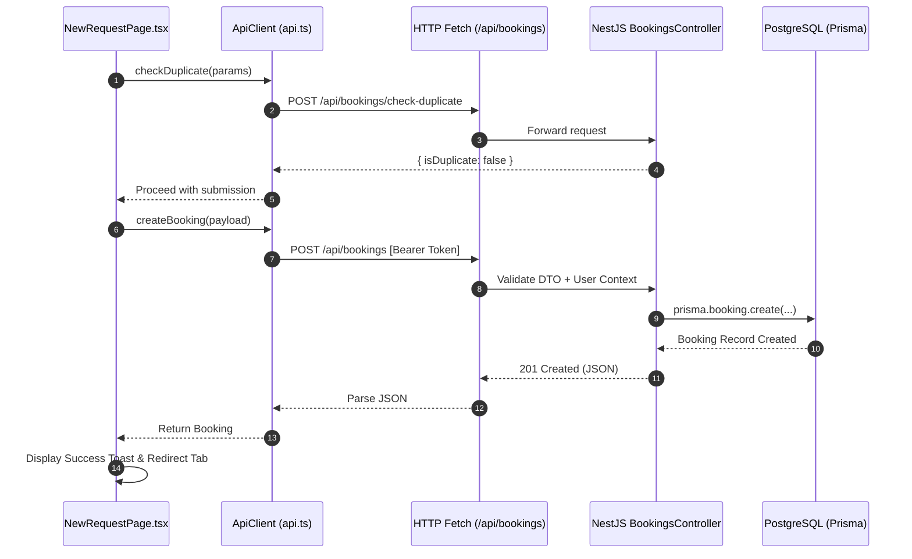

# 08 — API Integration and Data Flow

This document provides a comprehensive technical audit of the frontend API client architecture, HTTP communication patterns, authentication interceptors, data serialization, and an exhaustive inventory of all 47 API methods implemented in the **Capital Fleet** frontend application.

---

## 1. API Client Architecture and HTTP Configuration

### 1.1 HTTP Client Foundation
The frontend uses a singleton `ApiClient` class defined in [apps/web/src/lib/api.ts](file:///home/yeabsira-hailegiorgis/Documents/Capital%20Fleet/apps/web/src/lib/api.ts). It wraps the native browser `fetch` API, providing uniform request formatting, authentication header injection, and typed JSON response parsing.

- **Base URL:** Defined as `const API_BASE = '/api';`. In development, Vite proxies all requests matching `/api` to `http://localhost:4100` via [apps/web/vite.config.ts](file:///home/yeabsira-hailegiorgis/Documents/Capital%20Fleet/apps/web/vite.config.ts). In production, an Nginx reverse proxy routes `/api` to the backend Docker container.
- **Request Headers:**
  - `Content-Type: application/json` is automatically set for all requests.
  - `Authorization: Bearer <token>` is injected on every request when a valid JWT token exists in memory or session storage.
- **Token Persistence:**
  - On login, the JWT access token is stored in `sessionStorage.setItem('capital_fleet_token', token)`.
  - On page refresh, the `ApiClient` constructor hydrates `this.token` from `sessionStorage.getItem('capital_fleet_token')`.
  - On logout, `this.token` is cleared from memory and removed via `sessionStorage.removeItem('capital_fleet_token')`.

### 1.2 Error Interception and Normalization
The `request<T>()` private pipeline implements automated error unwrapping:

```typescript
if (!response.ok) {
  let errorMessage = 'An unexpected error occurred';
  try {
    const errorData = await response.json();
    errorMessage = Array.isArray(errorData.message)
      ? errorData.message.join(', ')
      : errorData.message || errorMessage;
  } catch {
    errorMessage = `HTTP error ${response.status}: ${response.statusText}`;
  }
  throw new Error(errorMessage);
}
```

This ensures that NestJS validation errors (`class-validator` arrays) are automatically flattened into human-readable strings before being caught by component UI handlers and presented in toast notifications.

---

## 2. Complete Inventory of Frontend API Endpoints

The following master table catalogs all 47 verified API methods in [apps/web/src/lib/api.ts](file:///home/yeabsira-hailegiorgis/Documents/Capital%20Fleet/apps/web/src/lib/api.ts):

| Domain | Method | Endpoint | Service Function | Input Payload / Query | Response Model | Caller Component / Page | Status |
|---|---|---|---|---|---|---|---|
| **Auth** | `POST` | `/api/auth/login` | `api.login` | `{ identifier, password }` | `{ accessToken, user }` | [LoginPage.tsx](file:///home/yeabsira-hailegiorgis/Documents/Capital%20Fleet/apps/web/src/pages/LoginPage.tsx) | **Verified** |
| **Auth** | `GET` | `/api/auth/me` | `api.getProfile` | None | `User` | [AuthContext.tsx](file:///home/yeabsira-hailegiorgis/Documents/Capital%20Fleet/apps/web/src/context/AuthContext.tsx) | **Verified** |
| **Auth** | `POST` | `/api/auth/logout` | `api.logout` | None | `{}` | [Navbar.tsx](file:///home/yeabsira-hailegiorgis/Documents/Capital%20Fleet/apps/web/src/components/layout/Navbar.tsx) | **Verified** |
| **Auth** | `POST` | `/api/auth/forgot-password` | `api.forgotPassword` | `{ identifier }` | `{ success, message, resetToken }` | [ForgotPasswordModal.tsx](file:///home/yeabsira-hailegiorgis/Documents/Capital%20Fleet/apps/web/src/components/ForgotPasswordModal.tsx) | **Verified** |
| **Auth** | `POST` | `/api/auth/reset-password` | `api.resetPassword` | `{ token, newPassword }` | `{ success, message }` | [ResetPasswordModal.tsx](file:///home/yeabsira-hailegiorgis/Documents/Capital%20Fleet/apps/web/src/components/ResetPasswordModal.tsx) | **Verified** |
| **Auth** | `POST` | `/api/auth/change-password` | `api.changePassword` | `{ currentPassword, newPassword }` | `{ success, message }` | [ProfileModal.tsx](file:///home/yeabsira-hailegiorgis/Documents/Capital%20Fleet/apps/web/src/components/layout/ProfileModal.tsx) | **Verified** |
| **Auth** | `POST` | `/api/auth/admin/reset-password/:id` | `api.adminResetPassword` | `{ forcePasswordChange }` | `{ success, resetToken }` | [UsersPage.tsx](file:///home/yeabsira-hailegiorgis/Documents/Capital%20Fleet/apps/web/src/pages/UsersPage.tsx) | **Verified** |
| **Bookings** | `POST` | `/api/bookings` | `api.createBooking` | `BookingCreateDto` | `Booking` | [NewRequestPage.tsx](file:///home/yeabsira-hailegiorgis/Documents/Capital%20Fleet/apps/web/src/pages/NewRequestPage.tsx) | **Verified** |
| **Bookings** | `GET` | `/api/bookings` | `api.getBookings` | `?status&search&from&to` | `Booking[]` | [BookingsPage.tsx](file:///home/yeabsira-hailegiorgis/Documents/Capital%20Fleet/apps/web/src/pages/BookingsPage.tsx), [ApprovalsPage.tsx](file:///home/yeabsira-hailegiorgis/Documents/Capital%20Fleet/apps/web/src/pages/ApprovalsPage.tsx) | **Verified** |
| **Bookings** | `GET` | `/api/bookings/:id` | `api.getBooking` | `id: string` | `Booking` | [GatePassModal.tsx](file:///home/yeabsira-hailegiorgis/Documents/Capital%20Fleet/apps/web/src/components/GatePassModal.tsx) | **Verified** |
| **Bookings** | `PATCH` | `/api/bookings/:id/cancel` | `api.cancelBooking` | `{ reason, notes }` | `Booking` | [BookingsPage.tsx](file:///home/yeabsira-hailegiorgis/Documents/Capital%20Fleet/apps/web/src/pages/BookingsPage.tsx) | **Verified** |
| **Bookings** | `POST` | `/api/bookings/:id/approve` | `api.approveBooking` | None | `Booking` | [ApprovalsPage.tsx](file:///home/yeabsira-hailegiorgis/Documents/Capital%20Fleet/apps/web/src/pages/ApprovalsPage.tsx) | **Verified** |
| **Bookings** | `POST` | `/api/bookings/:id/reject` | `api.rejectBooking` | `{ rejectionReason }` | `Booking` | [ApprovalsPage.tsx](file:///home/yeabsira-hailegiorgis/Documents/Capital%20Fleet/apps/web/src/pages/ApprovalsPage.tsx) | **Verified** |
| **Bookings** | `POST` | `/api/bookings/:id/assign` | `api.assignVehicle` | `{ vehicleId, driverId, notes }` | `VehicleAssignment` | [ChauffeurDispatchModal.tsx](file:///home/yeabsira-hailegiorgis/Documents/Capital%20Fleet/apps/web/src/components/ChauffeurDispatchModal.tsx) | **Verified** |
| **Bookings** | `POST` | `/api/bookings/:id/auto-assign` | `api.autoAssignBooking` | None | `VehicleAssignment` | [DispatchPage.tsx](file:///home/yeabsira-hailegiorgis/Documents/Capital%20Fleet/apps/web/src/pages/DispatchPage.tsx) | **Verified** |
| **Bookings** | `POST` | `/api/bookings/assignments/:id/confirm` | `api.confirmAssignment` | None | `VehicleAssignment` | [DriverPortalPage.tsx](file:///home/yeabsira-hailegiorgis/Documents/Capital%20Fleet/apps/web/src/pages/DriverPortalPage.tsx) | **Verified** |
| **Bookings** | `POST` | `/api/bookings/assignments/:id/decline` | `api.declineAssignment` | `{ reason }` | `VehicleAssignment` | [DriverPortalPage.tsx](file:///home/yeabsira-hailegiorgis/Documents/Capital%20Fleet/apps/web/src/pages/DriverPortalPage.tsx) | **Verified** |
| **Bookings** | `POST` | `/api/bookings/:id/start-trip` | `api.startTrip` | `{ startOdometer }` | `Booking` | [DriverPortalPage.tsx](file:///home/yeabsira-hailegiorgis/Documents/Capital%20Fleet/apps/web/src/pages/DriverPortalPage.tsx) | **Verified** |
| **Bookings** | `POST` | `/api/bookings/:id/mark-arrival` | `api.markArrival` | None | `Booking` | [DriverPortalPage.tsx](file:///home/yeabsira-hailegiorgis/Documents/Capital%20Fleet/apps/web/src/pages/DriverPortalPage.tsx) | **Verified** |
| **Bookings** | `POST` | `/api/bookings/:id/report-delay` | `api.reportDelay` | `{ reason }` | `Booking` | [DriverPortalPage.tsx](file:///home/yeabsira-hailegiorgis/Documents/Capital%20Fleet/apps/web/src/pages/DriverPortalPage.tsx) | **Verified** |
| **Bookings** | `POST` | `/api/bookings/:id/complete-trip` | `api.completeTrip` | `{ endOdometer, tripNotes }` | `Booking` | [DriverPortalPage.tsx](file:///home/yeabsira-hailegiorgis/Documents/Capital%20Fleet/apps/web/src/pages/DriverPortalPage.tsx) | **Verified** |
| **Bookings** | `POST` | `/api/bookings/check-duplicate` | `api.checkDuplicate` | `{ tripDate, destination }` | `{ isDuplicate, matches }` | [NewRequestPage.tsx](file:///home/yeabsira-hailegiorgis/Documents/Capital%20Fleet/apps/web/src/pages/NewRequestPage.tsx) | **Verified** |
| **Bookings** | `GET` | `/api/bookings/stats` | `api.getLogisticsDashboardStats` | None | `LogisticsDashboardStats` | [DashboardPage.tsx](file:///home/yeabsira-hailegiorgis/Documents/Capital%20Fleet/apps/web/src/pages/DashboardPage.tsx) | **Verified** |
| **Bookings** | `GET` | `/api/bookings/verify/:ref` | `api.verifyBooking` | `ref: string` | `BookingVerificationResult` | [PublicVerificationPage.tsx](file:///home/yeabsira-hailegiorgis/Documents/Capital%20Fleet/apps/web/src/pages/PublicVerificationPage.tsx) | **Verified** |
| **Bookings** | `GET` | `/api/bookings/verify-token/:token` | `api.verifyTripToken` | `token: string` | `BookingVerificationResult` | [PublicVerificationPage.tsx](file:///home/yeabsira-hailegiorgis/Documents/Capital%20Fleet/apps/web/src/pages/PublicVerificationPage.tsx) | **Verified** |
| **Bookings** | `PATCH` | `/api/bookings/days/:dayId` | `api.updateBookingDay` | `{ status, vehicleId, notes }` | `any` | [BookingsPage.tsx](file:///home/yeabsira-hailegiorgis/Documents/Capital%20Fleet/apps/web/src/pages/BookingsPage.tsx) | **Verified** |
| **Vehicles** | `GET` | `/api/vehicles` | `api.getVehicles` | `?search&category&status` | `Vehicle[]` | [VehiclesPage.tsx](file:///home/yeabsira-hailegiorgis/Documents/Capital%20Fleet/apps/web/src/pages/VehiclesPage.tsx), [DispatchPage.tsx](file:///home/yeabsira-hailegiorgis/Documents/Capital%20Fleet/apps/web/src/pages/DispatchPage.tsx) | **Verified** |
| **Vehicles** | `GET` | `/api/vehicles/:id` | `api.getVehicle` | `id: string` | `Vehicle & { issues }` | [VehicleDetailsModal.tsx](file:///home/yeabsira-hailegiorgis/Documents/Capital%20Fleet/apps/web/src/components/VehicleDetailsModal.tsx) | **Verified** |
| **Vehicles** | `POST` | `/api/vehicles` | `api.createVehicle` | `Partial<Vehicle>` | `Vehicle` | [VehiclesPage.tsx](file:///home/yeabsira-hailegiorgis/Documents/Capital%20Fleet/apps/web/src/pages/VehiclesPage.tsx) | **Verified** |
| **Vehicles** | `PATCH` | `/api/vehicles/:id` | `api.updateVehicle` | `Partial<Vehicle>` | `Vehicle` | [VehiclesPage.tsx](file:///home/yeabsira-hailegiorgis/Documents/Capital%20Fleet/apps/web/src/pages/VehiclesPage.tsx) | **Verified** |
| **Vehicles** | `GET` | `/api/vehicles/availability` | `api.getFleetAvailability` | `?departureAt&expectedReturnAt` | `AvailabilityReport[]` | [DispatchPage.tsx](file:///home/yeabsira-hailegiorgis/Documents/Capital%20Fleet/apps/web/src/pages/DispatchPage.tsx) | **Verified** |
| **Vehicles** | `GET` | `/api/vehicles/recommendations/:id` | `api.getVehicleRecommendations`| `bookingId: string` | `VehicleRecommendation[]` | [ChauffeurDispatchModal.tsx](file:///home/yeabsira-hailegiorgis/Documents/Capital%20Fleet/apps/web/src/components/ChauffeurDispatchModal.tsx) | **Verified** |
| **Vehicles** | `GET` | `/api/vehicles/driver-recommendations/:id` | `api.getDriverRecommendations` | `bookingId: string` | `DriverRecommendation[]` | [ChauffeurDispatchModal.tsx](file:///home/yeabsira-hailegiorgis/Documents/Capital%20Fleet/apps/web/src/components/ChauffeurDispatchModal.tsx) | **Verified** |
| **Issues** | `GET` | `/api/vehicle-issues` | `api.getIssues` | `?status&vehicleId` | `VehicleIssue[]` | [MaintenancePage.tsx](file:///home/yeabsira-hailegiorgis/Documents/Capital%20Fleet/apps/web/src/pages/MaintenancePage.tsx) | **Verified** |
| **Issues** | `POST` | `/api/vehicle-issues` | `api.reportIssue` | `{ vehicleId, description, severity }` | `{ issue, maintenanceSet }` | [VehicleDetailsModal.tsx](file:///home/yeabsira-hailegiorgis/Documents/Capital%20Fleet/apps/web/src/components/VehicleDetailsModal.tsx) | **Verified** |
| **Issues** | `PATCH` | `/api/vehicle-issues/:id` | `api.updateIssue` | `{ status, resolutionNotes }` | `VehicleIssue` | [MaintenancePage.tsx](file:///home/yeabsira-hailegiorgis/Documents/Capital%20Fleet/apps/web/src/pages/MaintenancePage.tsx) | **Verified** |
| **Maintenance** | `GET` | `/api/maintenance` | `api.getMaintenance` | `?vehicleId` | `VehicleMaintenance[]` | [MaintenancePage.tsx](file:///home/yeabsira-hailegiorgis/Documents/Capital%20Fleet/apps/web/src/pages/MaintenancePage.tsx) | **Verified** |
| **Maintenance** | `GET` | `/api/maintenance/overview` | `api.getMaintenanceOverview` | None | `any` | [MaintenancePage.tsx](file:///home/yeabsira-hailegiorgis/Documents/Capital%20Fleet/apps/web/src/pages/MaintenancePage.tsx) | **Verified** |
| **Maintenance** | `POST` | `/api/maintenance` | `api.createMaintenance` | `Partial<VehicleMaintenance>` | `VehicleMaintenance` | [MaintenanceFormModal.tsx](file:///home/yeabsira-hailegiorgis/Documents/Capital%20Fleet/apps/web/src/components/MaintenanceFormModal.tsx) | **Verified** |
| **Maintenance** | `PATCH` | `/api/maintenance/:id` | `api.updateMaintenance` | `Partial<VehicleMaintenance>` | `VehicleMaintenance` | [MaintenanceFormModal.tsx](file:///home/yeabsira-hailegiorgis/Documents/Capital%20Fleet/apps/web/src/components/MaintenanceFormModal.tsx) | **Verified** |
| **Maintenance** | `DELETE` | `/api/maintenance/:id` | `api.deleteMaintenance` | `id: string` | `{ success: boolean }` | [MaintenancePage.tsx](file:///home/yeabsira-hailegiorgis/Documents/Capital%20Fleet/apps/web/src/pages/MaintenancePage.tsx) | **Verified** |
| **Fuel** | `GET` | `/api/fuel` | `api.getFuelRecords` | `?vehicleId` | `FuelRecord[]` | [FuelManagementPage.tsx](file:///home/yeabsira-hailegiorgis/Documents/Capital%20Fleet/apps/web/src/pages/FuelManagementPage.tsx) | **Verified** |
| **Fuel** | `GET` | `/api/fuel/stats` | `api.getFuelStats` | None | `FuelStats` | [FuelManagementPage.tsx](file:///home/yeabsira-hailegiorgis/Documents/Capital%20Fleet/apps/web/src/pages/FuelManagementPage.tsx) | **Verified** |
| **Fuel** | `POST` | `/api/fuel` | `api.createFuelRecord` | `Partial<FuelRecord>` | `FuelRecord` | [FuelManagementPage.tsx](file:///home/yeabsira-hailegiorgis/Documents/Capital%20Fleet/apps/web/src/pages/FuelManagementPage.tsx) | **Verified** |
| **Notifications** | `GET` | `/api/notifications` | `api.getNotifications` | None | `InAppNotification[]` | [Navbar.tsx](file:///home/yeabsira-hailegiorgis/Documents/Capital%20Fleet/apps/web/src/components/layout/Navbar.tsx) | **Verified** |
| **Notifications** | `PATCH` | `/api/notifications/:id/read` | `api.markNotificationRead` | `id: string` | `InAppNotification` | [Navbar.tsx](file:///home/yeabsira-hailegiorgis/Documents/Capital%20Fleet/apps/web/src/components/layout/Navbar.tsx) | **Verified** |
| **Notifications** | `POST` | `/api/notifications/read-all` | `api.markAllNotificationsRead` | None | `void` | [Navbar.tsx](file:///home/yeabsira-hailegiorgis/Documents/Capital%20Fleet/apps/web/src/components/layout/Navbar.tsx) | **Verified** |
| **Audit Logs** | `GET` | `/api/audit-logs` | `api.getAuditLogs` | `?entityType&entityId` | `AuditLog[]` | [AuditLogsPage.tsx](file:///home/yeabsira-hailegiorgis/Documents/Capital%20Fleet/apps/web/src/pages/AuditLogsPage.tsx) | **Verified** |
| **Users** | `GET` | `/api/users` | `api.getUsers` | None | `User[]` | [UsersPage.tsx](file:///home/yeabsira-hailegiorgis/Documents/Capital%20Fleet/apps/web/src/pages/UsersPage.tsx), [DriversPage.tsx](file:///home/yeabsira-hailegiorgis/Documents/Capital%20Fleet/apps/web/src/pages/DriversPage.tsx) | **Verified** |
| **Users** | `POST` | `/api/users` | `api.createUser` | `CreateUserDto` | `User` | [UsersPage.tsx](file:///home/yeabsira-hailegiorgis/Documents/Capital%20Fleet/apps/web/src/pages/UsersPage.tsx) | **Verified** |
| **Users** | `PATCH` | `/api/users/:id` | `api.updateUser` | `Partial<User>` | `User` | [UsersPage.tsx](file:///home/yeabsira-hailegiorgis/Documents/Capital%20Fleet/apps/web/src/pages/UsersPage.tsx) | **Verified** |
| **Users** | `GET` | `/api/users/profile/me` | `api.getOwnProfile` | None | `User` | [ProfileModal.tsx](file:///home/yeabsira-hailegiorgis/Documents/Capital%20Fleet/apps/web/src/components/layout/ProfileModal.tsx) | **Verified** |
| **Users** | `PATCH` | `/api/users/profile/me` | `api.updateOwnProfile` | `{ name, phone, jobTitle }` | `User` | [ProfileModal.tsx](file:///home/yeabsira-hailegiorgis/Documents/Capital%20Fleet/apps/web/src/components/layout/ProfileModal.tsx) | **Verified** |
| **Departments** | `GET` | `/api/departments` | `api.getDepartments` | None | `Department[]` | [DepartmentsPage.tsx](file:///home/yeabsira-hailegiorgis/Documents/Capital%20Fleet/apps/web/src/pages/DepartmentsPage.tsx) | **Verified** |
| **Departments** | `POST` | `/api/departments` | `api.createDepartment` | `{ name, code, description }` | `Department` | [DepartmentsPage.tsx](file:///home/yeabsira-hailegiorgis/Documents/Capital%20Fleet/apps/web/src/pages/DepartmentsPage.tsx) | **Verified** |
| **Departments** | `PATCH` | `/api/departments/:id` | `api.updateDepartment` | `Partial<Department>` | `Department` | [DepartmentsPage.tsx](file:///home/yeabsira-hailegiorgis/Documents/Capital%20Fleet/apps/web/src/pages/DepartmentsPage.tsx) | **Verified** |
| **Departments** | `DELETE` | `/api/departments/:id` | `api.deleteDepartment` | `id: string` | `void` | [DepartmentsPage.tsx](file:///home/yeabsira-hailegiorgis/Documents/Capital%20Fleet/apps/web/src/pages/DepartmentsPage.tsx) | **Verified** |
| **Settings** | `GET` | `/api/settings` | `api.getSettings` | None | `SystemSettings` | [SettingsPage.tsx](file:///home/yeabsira-hailegiorgis/Documents/Capital%20Fleet/apps/web/src/pages/SettingsPage.tsx) | **Verified** |
| **Settings** | `PATCH` | `/api/settings` | `api.updateSettings` | `Partial<SystemSettings>` | `SystemSettings` | [SettingsPage.tsx](file:///home/yeabsira-hailegiorgis/Documents/Capital%20Fleet/apps/web/src/pages/SettingsPage.tsx) | **Verified** |
| **Settings** | `POST` | `/api/settings/danger/purge-operations` | `api.purgeOperationsData` | `{ adminPassword, phrase }` | `{ success, purgedSummary }` | [SettingsPage.tsx](file:///home/yeabsira-hailegiorgis/Documents/Capital%20Fleet/apps/web/src/pages/SettingsPage.tsx) | **Verified** |

---

## 3. Data Lifecycle and Mutation Flows

### 3.1 Booking Creation Data Flow
1. **User Action:** Employee fills trip details in [NewRequestPage.tsx](file:///home/yeabsira-hailegiorgis/Documents/Capital%20Fleet/apps/web/src/pages/NewRequestPage.tsx) and clicks "Submit".
2. **Duplicate Check:** Form automatically executes `api.checkDuplicate({ tripDate, destination })`. If matching trips are detected, the user is warned before submission.
3. **Payload Construction:** Request payload is assembled according to `BookingCreateDto`.
4. **Network Execution:** Handled via `api.createBooking(payload)`.
5. **State Update:** On `201 Created`, the local component triggers a notification toast, clears the input state, and requests parent tab transition to `bookings`.



### 3.2 Vehicle Assignment Flow
1. **Trigger:** Officer selects vehicle and chauffeur in [ChauffeurDispatchModal.tsx](file:///home/yeabsira-hailegiorgis/Documents/Capital%20Fleet/apps/web/src/components/ChauffeurDispatchModal.tsx).
2. **Network Execution:** Dispatches `api.assignVehicle(bookingId, { vehicleId, driverId })`.
3. **Optimistic/Pessimistic Handling:** The application disables the confirmation button and shows a spinner (`isLoading={true}`). On response, the modal dismisses and calls the parent's `onSuccess()` callback, which re-invokes `loadBookings()` to ensure complete state synchronization.

---

## 4. Query Caching, Invalidation, and Polling

- **No React Query / RTK Query:** The frontend deliberately does not use external caching libraries like `@tanstack/react-query`.
- **Component-Level Fetching:** Pages use `useEffect` hooks with local loading state (`const [loading, setLoading] = useState(true)`).
- **Navbar Polling:** [Navbar.tsx](file:///home/yeabsira-hailegiorgis/Documents/Capital%20Fleet/apps/web/src/components/layout/Navbar.tsx) sets up an active interval timer polling `api.getNotifications()` every 30 seconds to refresh the unread notification badge.
- **Cache Invalidation:** State invalidation is handled imperatively by re-invoking the page's data fetching method after a successful mutation (e.g., `loadBookings()`, `loadVehicles()`).
