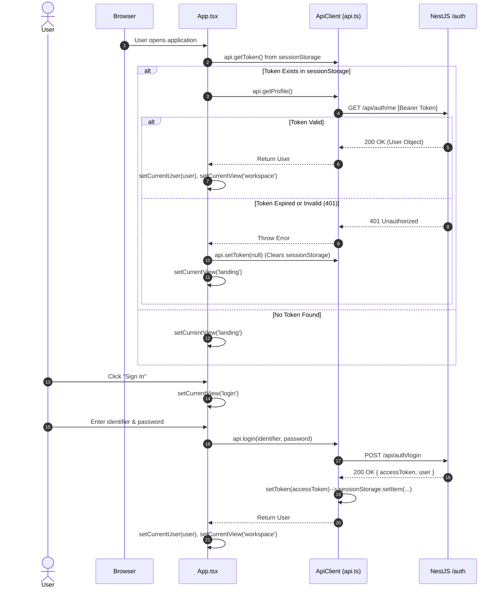

# 09 — Authentication, Authorization, and Security

This document details the frontend security architecture, user authentication flow, role-based access control (RBAC), session management, and client-side security boundaries implemented in the **Capital Fleet** application.

---

## 1. Authentication Architecture

### 1.1 Token Management & Storage
Capital Fleet uses JSON Web Token (JWT) Bearer authentication issued by the NestJS backend upon successful credential validation.

- **Storage Location:** `sessionStorage` under the key `'capital_fleet_token'`.
- **Security Justification:** Storing tokens in `sessionStorage` rather than `localStorage` provides superior defense against unauthorized session persistence on shared corporate workstation terminals:
  - The token is strictly scoped to the active browser tab.
  - Closing the browser tab or window immediately destroys the session token.
  - Opening a separate tab requires re-authentication, preventing cross-tab credential leakage.
- **Header Injection:** The singleton `ApiClient` ([apps/web/src/lib/api.ts](file:///home/yeabsira-hailegiorgis/Documents/Capital%20Fleet/apps/web/src/lib/api.ts)) intercepts every outgoing HTTP request, attaching the header `Authorization: Bearer <token>`.

### 1.2 Authentication Lifecycle Flow
The application lifecycle from cold boot to authenticated workspace proceeds as follows:



---

## 2. Public Verification Bypass

The system includes a dedicated bypass mechanism for gate security guards:

- **Trigger:** URL contains `?verify=<bookingId>` or `?ref=<referenceCode>`.
- **Implementation in `App.tsx`:**
  ```typescript
  const [verificationReference, setVerificationReference] = useState<string | null>(() => {
    if (typeof window !== 'undefined') {
      const params = new URLSearchParams(window.location.search);
      return params.get('token') || params.get('verify') || params.get('ref');
    }
    return null;
  });
  ```
- **Behavior:** When `isDirectScan` is true, the application bypasses landing, login, and workspace views entirely, rendering [PublicVerificationPage.tsx](file:///home/yeabsira-hailegiorgis/Documents/Capital%20Fleet/apps/web/src/pages/PublicVerificationPage.tsx).
- **Security Boundary:** The public verification endpoint (`GET /api/bookings/verify/:ref`) is intentionally unauthenticated on the backend, returning only read-only gate pass clearance data without exposing sensitive employee records or system credentials.

---

## 3. Role-Based Access Control (RBAC) on the Frontend

### 3.1 Role Hierarchy & Predicates
In [apps/web/src/App.tsx](file:///home/yeabsira-hailegiorgis/Documents/Capital%20Fleet/apps/web/src/App.tsx), user permissions are calculated using clear boolean predicates derived from `currentUser.role`:

```typescript
const isEmployee = currentUser?.role === 'EMPLOYEE';
const isLogisticsAdmin = currentUser?.role === 'LOGISTICS_ADMIN';
const isDriver = currentUser?.role === 'DRIVER';
const isSystemAdmin = currentUser?.role === 'SYSTEM_ADMIN';
const canAssignVehicles = isLogisticsAdmin || isSystemAdmin;
```

### 3.2 Role-Restricted Tab Rendering Matrix

| Tab Identifier | Component View | `EMPLOYEE` | `DRIVER` | `LOGISTICS_ADMIN` | `SYSTEM_ADMIN` |
|---|---|---|---|---|---|
| `dashboard` | `EmployeeDashboard` / `LogisticsDashboard` / `DriverDashboard` / `AdminAnalyticsDashboard` | **Role-Specific** | **Role-Specific** | **Role-Specific** | **Role-Specific** |
| `request` | `BookingRequestForm` | **Allowed** | Hidden | **Allowed** | **Allowed** |
| `bookings` | `BookingsTable` | **Allowed** | Hidden | **Allowed** | **Allowed** |
| `vehicles` | `VehicleInventoryView` | **Allowed** (Read) | **Allowed** (Read) | **Allowed** (Full) | **Allowed** (Full) |
| `dispatch` | `AssignVehicleModal` / Dispatch Queue | Blocked | Blocked | **Allowed** | **Allowed** |
| `drivers` | `DriversManagementView` | Blocked | Blocked | **Allowed** | **Allowed** |
| `maintenance` | `MaintenanceView` | **Allowed** (Report) | **Allowed** (Report) | **Allowed** (Full) | **Allowed** (Full) |
| `reports` | `ReportsHubView` | Blocked | Blocked | **Allowed** | **Allowed** |
| `users` | `UsersManagementView` | Blocked | Blocked | Blocked | **Allowed** |
| `departments` | `DepartmentsManagementView` | Blocked | Blocked | Blocked | **Allowed** |
| `settings` | `SystemSettingsView` | Blocked | Blocked | Blocked | **Allowed** |
| `audit-logs` | `AuditLogsView` | Blocked | Blocked | **Allowed** | **Allowed** |
| `profile-settings`| `ProfileSettingsView` | **Allowed** | **Allowed** | **Allowed** | **Allowed** |

---

## 4. Critical Distinction: Frontend Guard vs Backend Authorization

> [!IMPORTANT]
> **Client-Side Hiding is Not Security:**
> Hiding a tab in `AppShell.tsx` or conditionally not rendering a button in `ReviewRequestsQueue.tsx` only improves user experience; it does **not** protect against malicious requests.

### Real Backend Enforcement
The true security boundary is maintained on the NestJS API server via:
1. `JwtAuthGuard`: Enforces token validity, expiration, and user account status on all non-public routes.
2. `RolesGuard`: Enforces `@Roles('LOGISTICS_ADMIN', 'SYSTEM_ADMIN')` on administrative endpoints (e.g., `POST /api/bookings/:id/approve`, `POST /api/bookings/:id/assign`, `POST /api/users`).
3. **Database-Level Ownership Checks:** Employees querying `GET /api/bookings` are scoped by backend query logic to only retrieve bookings where `userId === req.user.id`.

---

## 5. Password Security & Danger Zone Protection

### 5.1 Password Management Flows
- **Self-Service Password Change:** Users can update their password in [ProfileModal.tsx](file:///home/yeabsira-hailegiorgis/Documents/Capital%20Fleet/apps/web/src/components/layout/ProfileModal.tsx). The form requires entering the `currentPassword` followed by `newPassword` (minimum 8 characters).
- **Administrator Password Reset:** In [UsersPage.tsx](file:///home/yeabsira-hailegiorgis/Documents/Capital%20Fleet/apps/web/src/pages/UsersPage.tsx), system administrators can trigger an immediate password reset for any user account. The API generates a temporary reset token and sets `forcePasswordChange = true`.

### 5.2 Danger Zone: Database Purge Protection
In [SystemSettingsView.tsx](file:///home/yeabsira-hailegiorgis/Documents/Capital%20Fleet/apps/web/src/features/admin/SystemSettingsView.tsx), the operational data purge functionality (which flushes historical bookings and assignments while preserving core fleet vehicles, drivers, and users) requires two-factor validation:
1. **Administrative Password Re-Authentication:** The administrator must enter their current login password.
2. **Explicit Confirmation Phrase Match:** The administrator must type the exact confirmation string:
   `"PURGE FLEET OPERATIONAL DATA"`
3. If either check fails, the frontend blocks the submission and the backend returns `403 Forbidden`.

---

## 6. Client-Side Security Audit Findings

| Security Area | Verified Implementation | Risk Level |
|---|---|---|
| **Hardcoded Secrets** | Zero API keys, passwords, or database connection strings exist in frontend source code. | **None** |
| **Token Storage** | Stored in `sessionStorage` (tab-isolated, destroyed on browser exit). | **Low** |
| **Cross-Site Scripting (XSS)** | React JSX automatically escapes dynamic values. `dangerouslySetInnerHTML` is not used anywhere in the codebase. | **Low** |
| **Input Sanitization** | Form fields trim whitespace and validate types before network dispatch. | **Low** |
| **Authentication Expiration** | 401 HTTP responses clear the session token and redirect to landing screen. | **Low** |
