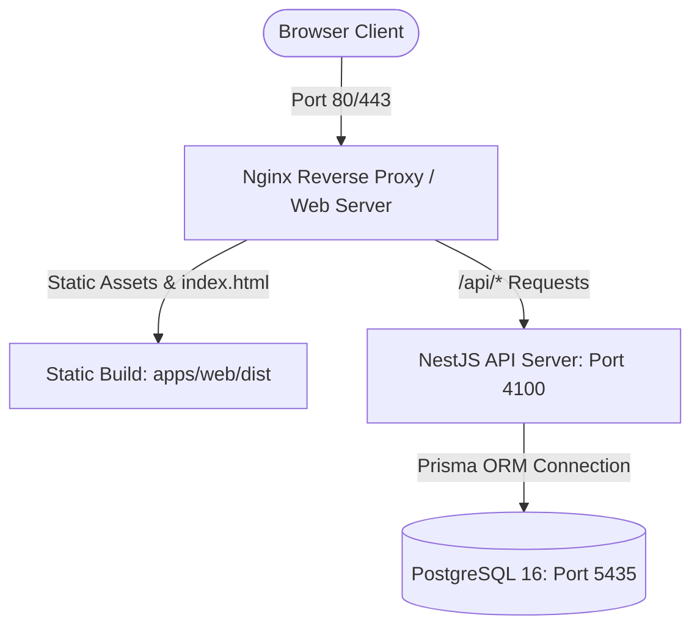

# 14 — Frontend Deployment and Runtime Configuration

This document provides a comprehensive technical guide to the development runtime environment, production build pipeline, web server hosting specifications, Nginx reverse proxy configuration, and containerized deployment for the **Capital Fleet** frontend application.

---

## 1. Development Runtime Environment

### 1.1 Prerequisites
- **Node.js:** Version 18.x or 20.x LTS.
- **Package Manager:** `npm` (v9 or v10).
- **PostgreSQL Database:** Docker container running PostgreSQL 16 on port 5435 (configured via [docker-compose.yml](file:///home/yeabsira-hailegiorgis/Documents/Capital%20Fleet/docker-compose.yml)).

### 1.2 Development Startup Commands
The monorepo provides several verified startup scripts defined in root [package.json](file:///home/yeabsira-hailegiorgis/Documents/Capital%20Fleet/package.json) and [start.sh](file:///home/yeabsira-hailegiorgis/Documents/Capital%20Fleet/start.sh):

```bash
# Option 1: Complete System Auto-Start (Recommended)
bash start.sh

# Option 2: Monorepo Parallel Development Mode
npm run dev

# Option 3: Dedicated Frontend-Only Development Server
npm run dev:web
```

### 1.3 Vite Development Proxy Configuration
In [apps/web/vite.config.ts](file:///home/yeabsira-hailegiorgis/Documents/Capital%20Fleet/apps/web/vite.config.ts), Vite routes API calls transparently to the backend server:

```typescript
export default defineConfig({
  plugins: [react()],
  resolve: {
    alias: {
      '@': path.resolve(__dirname, './src'),
    },
  },
  server: {
    port: 5173,
    proxy: {
      '/api': {
        target: 'http://localhost:4100',
        changeOrigin: true,
      },
    },
  },
});
```

---

## 2. Production Build and Artifact Distribution

### 2.1 Build Execution
To generate the optimized production bundle, execute:
```bash
npm run build:web
```

### 2.2 Output Directory Structure
The build generates self-contained static assets inside [apps/web/dist/](file:///home/yeabsira-hailegiorgis/Documents/Capital%20Fleet/apps/web/dist/):

```text
apps/web/dist/
├── index.html                   # Root SPA HTML entry shell (830 bytes)
├── assets/
│   ├── index-D7b3-F9-.css       # Minified Tailwind styles & keyframes (42.75 kB)
│   ├── index-BxV_8B2b.js        # Bundled application JS & dependencies (763.53 kB)
│   └── capital-emblem.png       # Corporate logo & branding vectors
└── favicon.ico                  # Application browser tab icon
```

---

## 3. Production Web Server & Nginx Configuration

Because Capital Fleet is a Single Page Application (SPA) using client-side routing and URL state synchronization (`?tab=...`, `?verify=...`), the production web server (Nginx or Caddy) must implement **SPA fallback routing** to prevent 404 errors on browser refresh.

### 3.1 Recommended Production Nginx Configuration
```nginx
server {
    listen 80;
    server_name fleet.capitalrealestate.et;

    # Document root pointing to Vite production dist
    root /var/www/capital-fleet/apps/web/dist;
    index index.html;

    # Gzip compression
    gzip on;
    gzip_vary on;
    gzip_min_length 1024;
    gzip_proxied any;
    gzip_types text/plain text/css application/json application/javascript text/xml application/xml image/svg+xml;

    # Static assets with immutable content hashing
    location /assets/ {
        expires 1y;
        add_header Cache-Control "public, immutable";
    }

    # API Reverse Proxy (Routes network calls to backend NestJS container)
    location /api/ {
        proxy_pass http://127.0.0.1:4100/api/;
        proxy_http_version 1.1;
        proxy_set_header Upgrade $http_upgrade;
        proxy_set_header Connection 'upgrade';
        proxy_set_header Host $host;
        proxy_set_header X-Real-IP $remote_addr;
        proxy_set_header X-Forwarded-For $proxy_add_x_forwarded_for;
        proxy_set_header X-Forwarded-Proto $scheme;
        proxy_cache_bypass $http_upgrade;
    }

    # SPA Fallback: Route all non-file requests to index.html
    location / {
        try_files $uri $uri/ /index.html;
        add_header Cache-Control "no-cache, no-store, must-revalidate";
    }
}
```

---

## 4. Containerization and Infrastructure Topology

### 4.1 Database Container
Defined in [docker-compose.yml](file:///home/yeabsira-hailegiorgis/Documents/Capital%20Fleet/docker-compose.yml):
- **Image:** `postgres:16-alpine`
- **Container Name:** `capital_fleet_db`
- **Port:** `5435:5432`
- **Timezone:** `TZ=Africa/Addis_Ababa` (ensuring timestamps match local Ethiopian operational hours)
- **Healthcheck:** `pg_isready -U postgres -d capital_fleet_db`

### 4.2 System Architecture Diagram


---

## 5. Environment Variables & Secret Hygiene

### 5.1 Client Environment Variables
Vite exposes client-side variables prefixed with `VITE_`:
- `VITE_API_URL`: Optional custom API endpoint URL. When omitted, the frontend defaults to relative `/api`, which is optimal for proxy setups.

### 5.2 Client Secret Hygiene Audit
- **Verification:** Audited all 58 files in `apps/web/src/`.
- **Finding:** **Zero secrets** (database passwords, JWT secret keys, or cloud credentials) are referenced or embedded in the frontend source code or production JavaScript bundles.
