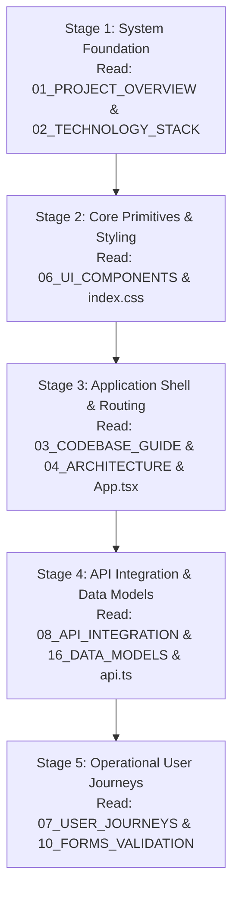

# 19 — Glossary and Frontend Learning Guide

This document provides a beginner-friendly technical glossary of core web development and software engineering concepts implemented in the **Capital Fleet** application, accompanied by real code examples and a structured learning roadmap.

---

## 1. Technical Concepts Glossary

### 1.1 Single-Page Application (SPA)
- **Plain-Language Definition:** A web application that loads a single HTML shell page once and dynamically updates the view as the user navigates, without reloading the entire page from the server.
- **Application in Capital Fleet:** Capital Fleet loads `index.html` once. When a user switches from "Dashboard" to "My Bookings", the interface swaps the visible component instantly without causing a browser reload flicker.
- **Project Example:** [apps/web/src/App.tsx](file:///home/yeabsira-hailegiorgis/Documents/Capital%20Fleet/apps/web/src/App.tsx) conditionally renders views inside the static [AppShell.tsx](file:///home/yeabsira-hailegiorgis/Documents/Capital%20Fleet/apps/web/src/components/layout/AppShell.tsx).

---

### 1.2 Component
- **Plain-Language Definition:** A self-contained, reusable building block of a user interface that manages its own markup, styling, and logic.
- **Application in Capital Fleet:** Elements like buttons, modals, cards, and tables are defined as separate components and reused throughout the app.
- **Project Example:** [apps/web/src/components/ui/Button.tsx](file:///home/yeabsira-hailegiorgis/Documents/Capital%20Fleet/apps/web/src/components/ui/Button.tsx) is reused across more than 20 separate pages and modals.

---

### 1.3 Props (Properties)
- **Plain-Language Definition:** Input arguments passed from a parent component down to a child component to customize its data or behavior.
- **Application in Capital Fleet:** A status badge receives a `status` prop (e.g., `'APPROVED'`) and configures its color and label accordingly.
- **Project Example:** [apps/web/src/components/ui/Badge.tsx](file:///home/yeabsira-hailegiorgis/Documents/Capital%20Fleet/apps/web/src/components/ui/Badge.tsx):
  ```tsx
  <Badge status={booking.status} size="sm" />
  ```

---

### 1.4 State
- **Plain-Language Definition:** Dynamic memory internal to a component that holds data which can change over time and causes the component to re-render when modified.
- **Application in Capital Fleet:** Tracking whether a modal dialog is currently open or closed, or tracking user input as they type into the destination field.
- **Project Example:** [apps/web/src/App.tsx](file:///home/yeabsira-hailegiorgis/Documents/Capital%20Fleet/apps/web/src/App.tsx):
  ```typescript
  const [activeTab, setActiveTab] = useState('dashboard');
  ```

---

### 1.5 Hook
- **Plain-Language Definition:** A special React function starting with `use` that allows functional components to "hook into" React features like state, lifecycle events, and contexts.
- **Application in Capital Fleet:** `useState` for local state, `useEffect` for data fetching on component mount, and `useToast` for triggering floating notification toasts.
- **Project Example:** [apps/web/src/components/ui/Toast.tsx](file:///home/yeabsira-hailegiorgis/Documents/Capital%20Fleet/apps/web/src/components/ui/Toast.tsx):
  ```typescript
  const toast = useToast();
  toast.success('Booking Approved', 'The request has been updated.');
  ```

---

### 1.6 Routing & URL State Synchronization
- **Plain-Language Definition:** The mechanism by which the application determines which screen to display based on the browser URL path or query parameters.
- **Application in Capital Fleet:** The application synchronizes `activeTab` with the browser address bar (`?tab=vehicles`) so users can refresh or bookmark direct links.
- **Project Example:** [apps/web/src/App.tsx](file:///home/yeabsira-hailegiorgis/Documents/Capital%20Fleet/apps/web/src/App.tsx#L59-L67).

---

### 1.7 REST API (Representational State Transfer)
- **Plain-Language Definition:** A standardized architectural style for transferring data over HTTP between a client (browser) and a server using standard methods (`GET`, `POST`, `PATCH`, `DELETE`).
- **Application in Capital Fleet:** The frontend communicates with the NestJS API server via endpoints like `GET /api/bookings` and `POST /api/bookings/:id/assign`.
- **Project Example:** [apps/web/src/lib/api.ts](file:///home/yeabsira-hailegiorgis/Documents/Capital%20Fleet/apps/web/src/lib/api.ts).

---

### 1.8 JSON (JavaScript Object Notation)
- **Plain-Language Definition:** A lightweight, text-based data exchange format readable by both humans and computers.
- **Application in Capital Fleet:** All network communication between the frontend client and the backend server is serialized as JSON payloads.
- **Project Example:**
  ```json
  {
    "destination": "Gotera Heights Site",
    "passengerCount": 4,
    "departureAt": "2026-10-27T08:30:00.000Z"
  }
  ```

---

### 1.9 JWT (JSON Web Token) & Authentication
- **Plain-Language Definition:** A digitally signed, encrypted token issued to a client upon successful login, which the client transmits in HTTP headers to prove its identity on subsequent requests.
- **Application in Capital Fleet:** On login, the backend returns an `accessToken`. The frontend saves this token in `sessionStorage` and attaches it as `Authorization: Bearer <token>` on all requests.
- **Project Example:** [apps/web/src/lib/api.ts](file:///home/yeabsira-hailegiorgis/Documents/Capital%20Fleet/apps/web/src/lib/api.ts#L54-L56).

---

### 1.10 Role-Based Access Control (RBAC)
- **Plain-Language Definition:** A security paradigm that restricts access to specific application features and resources based on the user's assigned role.
- **Application in Capital Fleet:** Employees can only see their own bookings; logistics administrators can access fleet assignment and approval queues; drivers can only see their assigned trips; system administrators have full governance.
- **Project Example:** [apps/web/src/App.tsx](file:///home/yeabsira-hailegiorgis/Documents/Capital%20Fleet/apps/web/src/App.tsx#L510-L536).

---

### 1.11 Asynchronous Operation & Promise
- **Plain-Language Definition:** A non-blocking operation (like fetching data over the network) that allows the browser interface to remain responsive while waiting for the server to respond.
- **Application in Capital Fleet:** When loading the vehicles directory, the frontend renders a loading skeleton while the `Promise` returned by `fetch()` resolves.
- **Project Example:** [apps/web/src/lib/api.ts](file:///home/yeabsira-hailegiorgis/Documents/Capital%20Fleet/apps/web/src/lib/api.ts#L48):
  ```typescript
  private async request<T>(endpoint: string, options: RequestInit = {}): Promise<T>
  ```

---

### 1.12 TypeScript Interface
- **Plain-Language Definition:** A compile-time blueprint that defines the shape, properties, and data types of an object, catching bugs before code runs.
- **Application in Capital Fleet:** Guarantees that every `Booking` object contains required fields like `bookingReference` and `destination`.
- **Project Example:** [apps/web/src/types/index.ts](file:///home/yeabsira-hailegiorgis/Documents/Capital%20Fleet/apps/web/src/types/index.ts#L75-L121).

---

### 1.13 Responsive Web Design
- **Plain-Language Definition:** A web engineering approach that makes an application adapt fluidly to any screen size—from smartphones and tablets to desktop monitors.
- **Application in Capital Fleet:** The navigation sidebar turns into a collapsible mobile drawer on screens $< 640\text{px}$, and KPI cards rearrange from 4 columns to 1 column.
- **Project Example:** [apps/web/src/components/layout/AppShell.tsx](file:///home/yeabsira-hailegiorgis/Documents/Capital%20Fleet/apps/web/src/components/layout/AppShell.tsx).

---

### 1.14 Accessibility (WCAG 2.1 AA)
- **Plain-Language Definition:** Designing user interfaces so that individuals with disabilities (e.g., visual impairment, motor limitations) can navigate and use the application effectively.
- **Application in Capital Fleet:** Modals implement keyboard Escape listeners, focus states are clearly highlighted, and color contrast ratios exceed 15:1.
- **Project Example:** [apps/web/src/components/ui/Modal.tsx](file:///home/yeabsira-hailegiorgis/Documents/Capital%20Fleet/apps/web/src/components/ui/Modal.tsx#L28-L41).

---

### 1.15 QR Code (Quick Response Code)
- **Plain-Language Definition:** A two-dimensional matrix barcode that can be scanned by camera devices to instantly read encoded URLs or text data.
- **Application in Capital Fleet:** Digital gate clearance passes generate a QR code encoding a secure verification URL that corporate security guards scan to verify vehicle clearance.
- **Project Example:** [apps/web/src/components/GatePassModal.tsx](file:///home/yeabsira-hailegiorgis/Documents/Capital%20Fleet/apps/web/src/components/GatePassModal.tsx).

---

## 2. Recommended Frontend Learning Roadmap

To understand the Capital Fleet codebase thoroughly, follow this recommended 5-stage reading path:



### Stage 1: System Foundation
1. Start with [01_PROJECT_OVERVIEW_AND_SYSTEM_CONTEXT.md](file:///home/yeabsira-hailegiorgis/Documents/Capital%20Fleet/docs/capital-fleet-frontend-documentation/01_PROJECT_OVERVIEW_AND_SYSTEM_CONTEXT.md) to understand the real-world business context of Capital Real Estate and the operational problems the system solves.
2. Read [02_FRONTEND_TECHNOLOGY_STACK_AND_SETUP.md](file:///home/yeabsira-hailegiorgis/Documents/Capital%20Fleet/docs/capital-fleet-frontend-documentation/02_FRONTEND_TECHNOLOGY_STACK_AND_SETUP.md) to understand the React, TypeScript, and Vite toolchain.

### Stage 2: UI Primitives and Design System
3. Review [06_UI_COMPONENTS_AND_REUSABLE_DESIGN_SYSTEM.md](file:///home/yeabsira-hailegiorgis/Documents/Capital%20Fleet/docs/capital-fleet-frontend-documentation/06_UI_COMPONENTS_AND_REUSABLE_DESIGN_SYSTEM.md) and inspect the atomic primitives (`Button`, `Card`, `Badge`, `Input`, `Modal`) in [apps/web/src/components/ui/](file:///home/yeabsira-hailegiorgis/Documents/Capital%20Fleet/apps/web/src/components/ui/).

### Stage 3: Shell Architecture and Application Bootstrap
4. Inspect [apps/web/src/App.tsx](file:///home/yeabsira-hailegiorgis/Documents/Capital%20Fleet/apps/web/src/App.tsx) and [04_FRONTEND_ARCHITECTURE_AND_DESIGN_PATTERNS.md](file:///home/yeabsira-hailegiorgis/Documents/Capital%20Fleet/docs/capital-fleet-frontend-documentation/04_FRONTEND_ARCHITECTURE_AND_DESIGN_PATTERNS.md) to understand how `sessionStorage` token hydration works and how tabs are rendered.

### Stage 4: API Integration and Data Models
5. Read [08_API_INTEGRATION_AND_DATA_FLOW.md](file:///home/yeabsira-hailegiorgis/Documents/Capital%20Fleet/docs/capital-fleet-frontend-documentation/08_API_INTEGRATION_AND_DATA_FLOW.md) and [16_FRONTEND_DATA_MODELS_AND_TYPES.md](file:///home/yeabsira-hailegiorgis/Documents/Capital%20Fleet/docs/capital-fleet-frontend-documentation/16_FRONTEND_DATA_MODELS_AND_TYPES.md) to learn how the frontend interacts with backend endpoints.

### Stage 5: Operational User Journeys
6. Study [07_USER_ROLES_AND_FRONTEND_USER_JOURNEYS.md](file:///home/yeabsira-hailegiorgis/Documents/Capital%20Fleet/docs/capital-fleet-frontend-documentation/07_USER_ROLES_AND_FRONTEND_USER_JOURNEYS.md) and [10_FORMS_VALIDATION_AND_ERROR_HANDLING.md](file:///home/yeabsira-hailegiorgis/Documents/Capital%20Fleet/docs/capital-fleet-frontend-documentation/10_FORMS_VALIDATION_AND_ERROR_HANDLING.md) to trace the end-to-end booking, approval, dispatch, gate pass, and trip execution workflows.
