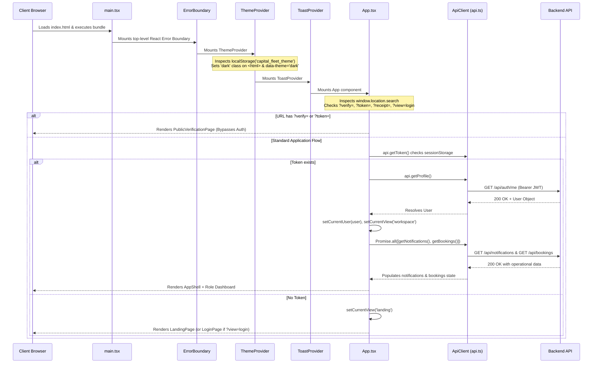
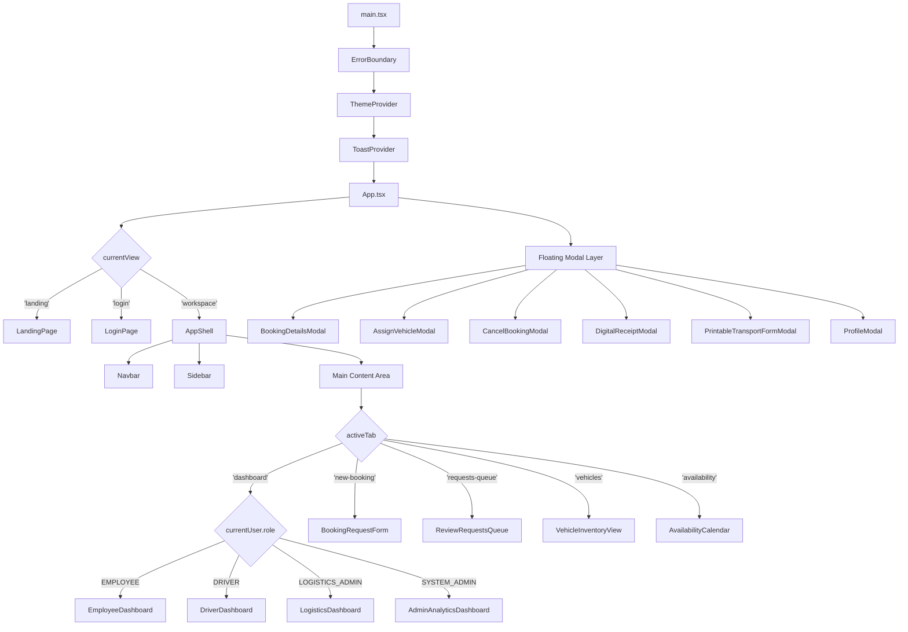

# Capital Real Estate Fleet Management System
## Deliverable 02: Frontend Architecture & Codebase Organization

---

### 1. Architectural Pattern & Design Philosophy

The **Capital Real Estate Fleet Management System** frontend is built as a single-page application (SPA) utilizing a **Modular Feature-Driven Architecture** combined with a cockpit-inspired automotive design system. The architecture separates structural application shell layouts, shared atomic UI components, encapsulated business domain features, centralized API client services, and application context providers.

Key architectural characteristics:
1. **Unidirectional Data Flow:** Data flows downward via typed props; user events trigger callback handlers that invoke the centralized API client and update top-level React state.
2. **Encapsulated Feature Slices:** Complex domains (such as Bookings, Logistics, Vehicles, Maintenance, and Admin) are isolated inside `src/features/`, housing their own views, modals, and business sub-components.
3. **Cockpit UI & Telemetry Components:** To reinforce the automotive domain, the application features telemetry components such as the live highway route simulation (`DynamicFleetRouteSimulation.tsx`), automotive journey spine (`AutomotiveJourneySpine.tsx`), and loading screens with automotive gauge animations (`AutomotiveLoadingScreen.tsx`).

---

### 2. Comprehensive Frontend Directory Tree

The complete frontend source tree in [`apps/web/src/`](file:///home/yeabsira-hailegiorgis/Documents/Capital%20Fleet/apps/web/src/) is structured as follows:

```
apps/web/
├── index.html                           # Single-page application HTML5 shell
├── package.json                         # Web frontend npm package configuration
├── postcss.config.js                    # PostCSS plugins configuration (Tailwind, Autoprefixer)
├── tailwind.config.js                   # Custom design system tokens, colors, & shadows
├── tsconfig.json                        # TypeScript compiler options & '@/*' path aliases
├── tsconfig.node.json                   # Vite Node environment TypeScript configuration
├── vite.config.ts                       # Vite bundler options, path aliases, & /api dev proxy
└── src/
    ├── App.tsx                          # Core application orchestrator, state router, & modal coordinator
    ├── main.tsx                         # Application bootstrap, DOM mounting, & global provider wrapping
    ├── index.css                        # Global CSS, Tailwind directives, dark mode rules, & print styles
    │
    ├── components/                      # Reusable, cross-feature components
    │   ├── automotive/                  # Automotive-themed visual and telemetry elements
    │   │   ├── AutomotiveJourneySpine.tsx     # Visual step indicator for vehicle dispatch milestones
    │   │   └── HighwaySectionConnector.tsx    # Styled connector line for journey checkpoints
    │   ├── layout/                      # Structural layout components
    │   │   ├── AppShell.tsx             # Primary workspace frame (sidebar, navbar, main viewport)
    │   │   ├── Navbar.tsx               # Top header with brand logo, live Addis Ababa time, theme & user dropdown
    │   │   ├── ProfileModal.tsx         # User profile edit dialog (phone, avatar URL, job title)
    │   │   └── Sidebar.tsx              # Role-filtered vertical navigation bar with active tab indicators
    │   ├── loading/                     # Loading and progress indicators
    │   │   └── AutomotiveLoadingScreen.tsx    # Initial splash animation simulating vehicle instrumentation
    │   ├── notifications/               # In-app notification components
    │   │   └── NotificationDetailsModal.tsx   # Detailed modal display for system alert notifications
    │   ├── telematics/                  # Telemetry and route visualizers
    │   │   └── DynamicFleetRouteSimulation.tsx# Interactive animated route simulator for dispatched vehicles
    │   └── ui/                          # Atomic, unstyled UI primitives
    │       ├── Alert.tsx                # Contextual alert banner (info, success, warning, error)
    │       ├── Badge.tsx                # Status pill indicator (available, assigned, completed, etc.)
    │       ├── BrandLogo.tsx            # Capital Real Estate corporate emblem and typography
    │       ├── Button.tsx               # Versatile button component with variant and loading states
    │       ├── Card.tsx                 # Content card container with header, title, and body
    │       ├── ErrorBoundary.tsx        # React class error boundary preventing catastrophic crashes
    │       ├── Input.tsx                # Standardized text input field with error states
    │       ├── Modal.tsx                # Base accessible modal dialog with backdrop blur and ESC handler
    │       ├── SmartDropdown.tsx        # Collision-aware dropdown with auto-repositioning
    │       └── Toast.tsx                # Toast alert notifications system with ToastContext provider
    │
    ├── context/                         # Global React context providers
    │   └── ThemeContext.tsx             # Dark/Light theme provider with localStorage & tab sync
    │
    ├── features/                        # Domain-driven business feature modules
    │   ├── admin/                       # System administration and executive oversight
    │   │   ├── AddEmployeeModal.tsx           # Modal dialog to provision new staff, drivers, or admins
    │   │   ├── AuditLogsView.tsx              # System audit trail table displaying operational mutations
    │   │   ├── DepartmentsManagementView.tsx  # Department CRUD view with manager & budget tracking
    │   │   ├── SystemSettingsView.tsx         # Security settings view (lockouts, notice hours, passwords)
    │   │   └── UsersManagementView.tsx        # User accounts management view with search and filters
    │   ├── auth/                        # Authentication feature sub-components
    │   │   └── ForgotPasswordModal.tsx        # Password reset request and PIN verification dialog
    │   ├── availability/                # Fleet scheduling and availability calendar
    │   │   └── AvailabilityCalendar.tsx       # Timeline calendar showing vehicles, trips, and conflicts
    │   ├── bookings/                    # Employee booking lifecycle components
    │   │   ├── BookingDetailsModal.tsx        # Comprehensive inspection modal for a single booking
    │   │   ├── BookingRequestForm.tsx         # Form for Daily & Weekly transport requests
    │   │   ├── BookingsTable.tsx              # Paginated, filterable table of trip bookings
    │   │   ├── BookingVerificationModal.tsx   # In-app QR code verification dialog
    │   │   ├── CancelBookingModal.tsx         # Cancellation confirmation dialog with mandatory reason
    │   │   ├── DigitalReceiptModal.tsx        # Security gate pass & digital receipt with live QR code
    │   │   └── PrintableTransportFormModal.tsx# Formal printed transport requisition order (@media print)
    │   ├── dashboard/                   # Role-specific executive and operational dashboards
    │   │   ├── AdminAnalyticsDashboard.tsx    # High-level KPIs, fleet utilization, and department breakdowns
    │   │   ├── DriverDashboard.tsx            # Driver mission dashboard with odometer and arrival logging
    │   │   ├── EmployeeDashboard.tsx          # Employee portal with quick booking actions and my trips
    │   │   └── LogisticsDashboard.tsx         # Logistics command center with pending queues and fleet status
    │   ├── drivers/                     # Chauffeur registry management
    │   │   └── DriversManagementView.tsx      # Chauffeurs table with license tracking and trip stats
    │   ├── logistics/                   # Transport operations review and allocation
    │   │   ├── AssignVehicleModal.tsx         # Allocation modal with recommendation engine and conflict checks
    │   │   ├── ReviewRequestsQueue.tsx        # Multi-tab operational queue (Pending, Approved, Assigned, All)
    │   │   └── TripExecutionModal.tsx         # Odometer logging modal for starting and completing trips
    │   ├── maintenance/                 # Fleet health and repair tracking
    │   │   └── MaintenanceView.tsx            # Vehicle issues, maintenance records, and repair logging
    │   ├── profile/                     # User profile settings
    │   │   └── ProfileSettingsView.tsx        # Account preferences, contact details, and password change
    │   ├── reports/                     # Operational reporting and data export
    │   │   └── ReportsHubView.tsx             # Analytical reports hub with CSV export capabilities
    │   └── vehicles/                    # Fleet vehicle inventory
    │       ├── VehicleInventoryView.tsx       # Grid/table view of corporate vehicles with status filters
    │       └── VehicleModal.tsx               # Modal to add or update vehicle specifications
    │
    ├── lib/                             # Shared utility libraries and service clients
    │   ├── api.ts                       # Centralized ApiClient singleton wrapping native fetch
    │   ├── csvExport.ts                 # Client-side CSV generation and file download utility
    │   ├── imageUtils.ts                # Avatar and vehicle image fallbacks and placeholders
    │   └── utils.ts                     # cn() class merger and formatEthiopianDateTime() date utilities
    │
    ├── pages/                           # Full-page view containers
    │   ├── LandingPage.tsx              # Public corporate landing page with hero banner and features
    │   ├── LoginPage.tsx                # Corporate sign-in page with credential validation
    │   └── PublicVerificationPage.tsx   # Standalone, unauthenticated gate pass verification portal
    │
    └── types/                           # Centralized TypeScript declarations
        └── index.ts                     # Interfaces for User, Vehicle, Booking, Assignment, etc.
```

---

### 3. Application Initialization & Startup Flow

The application initialization sequence is strictly deterministic, beginning in [`apps/web/src/main.tsx`](file:///home/yeabsira-hailegiorgis/Documents/Capital%20Fleet/apps/web/src/main.tsx):

```typescript
// apps/web/src/main.tsx
ReactDOM.createRoot(document.getElementById('root')!).render(
  <React.StrictMode>
    <ErrorBoundary>
      <ThemeProvider>
        <ToastProvider>
          <App />
        </ToastProvider>
      </ThemeProvider>
    </ErrorBoundary>
  </React.StrictMode>,
);
```

#### Step-by-Step Initialization Sequence:



1. **DOM Attachment:** `ReactDOM.createRoot` acquires the `#root` element in `index.html`.
2. **Error Safeguard:** `<ErrorBoundary>` wraps the entire React tree, catching uncaught render errors and rendering a fallback error UI with a recovery button.
3. **Theme Initialization:** `<ThemeProvider>` inspects `localStorage` for `capital_fleet_theme`. If absent, it queries `window.matchMedia('(prefers-color-scheme: dark)')`, defaulting to modern dark mode. It adds the `.dark` class to `document.documentElement` and sets `data-theme="dark"`. It also listens to `storage` events to synchronize theme changes across open tabs.
4. **Toast Context Setup:** `<ToastProvider>` initializes a floating notification container fixed at the bottom-right of the screen for non-intrusive feedback.
5. **Session Verification & Route Bootstrapping:** In `App.tsx`, the component checks whether the URL contains public verification parameters (`?verify=`, `?token=`, or `?ref=`). If detected, it immediately bypasses normal layout rendering and renders [`PublicVerificationPage.tsx`](file:///home/yeabsira-hailegiorgis/Documents/Capital%20Fleet/apps/web/src/pages/PublicVerificationPage.tsx).
6. **Token Resumption:** If not a direct scan, `App.tsx` reads `sessionStorage.getItem('capital_fleet_token')`. If present, it executes `api.getProfile()`. If valid, `currentUser` is set, `currentView` switches to `'workspace'`, and initial data (`getNotifications`, `getBookings`) is loaded in parallel. If invalid or expired, the token is purged and the user is directed to `'landing'`.

---

### 4. Routing Architecture & Tab Switching

Rather than employing a client-side routing library such as `react-router-dom`, the application implements a **State-Driven View & Tab Router** orchestrated within [`App.tsx`](file:///home/yeabsira-hailegiorgis/Documents/Capital%20Fleet/apps/web/src/App.tsx).

#### 4.1 Top-Level View Switching
The application switches between three major top-level views managed by `currentView`:
* `'landing'`: Public corporate landing page ([`LandingPage.tsx`](file:///home/yeabsira-hailegiorgis/Documents/Capital%20Fleet/apps/web/src/pages/LandingPage.tsx)).
* `'login'`: Authentication page ([`LoginPage.tsx`](file:///home/yeabsira-hailegiorgis/Documents/Capital%20Fleet/apps/web/src/pages/LoginPage.tsx)).
* `'workspace'`: The authenticated corporate portal wrapped in [`AppShell.tsx`](file:///home/yeabsira-hailegiorgis/Documents/Capital%20Fleet/apps/web/src/components/layout/AppShell.tsx).

#### 4.2 Workspace Tab Routing
Inside `'workspace'`, navigation is dictated by `activeTab: string`. The available tabs vary strictly according to the authenticated user's role:

| `activeTab` Identifier | Display Label | Rendered Feature Component | Authorized Roles |
|:---|:---|:---|:---|
| `'dashboard'` | Dashboard Overview | `DriverDashboard` / `EmployeeDashboard` / `LogisticsDashboard` / `AdminAnalyticsDashboard` | All Roles (Role-Specific) |
| `'new-booking'` | Book a Vehicle | `BookingRequestForm` | `EMPLOYEE`, `LOGISTICS_ADMIN`, `SYSTEM_ADMIN` |
| `'my-bookings'` | My Bookings | `BookingsTable` | `EMPLOYEE` |
| `'requests-queue'` | Transport Requests | `ReviewRequestsQueue` (`initialTab="pending"`) | `LOGISTICS_ADMIN`, `SYSTEM_ADMIN` |
| `'assign-queue'` | Assign Vehicles | `ReviewRequestsQueue` (`initialTab="approved"`) | `LOGISTICS_ADMIN`, `SYSTEM_ADMIN` |
| `'weekly-requests'` | Weekly Requests | `ReviewRequestsQueue` (`requestType="WEEKLY"`) | `LOGISTICS_ADMIN`, `SYSTEM_ADMIN` |
| `'availability'` | Schedule / Calendar | `AvailabilityCalendar` | All Roles |
| `'vehicles'` | Fleet Inventory | `VehicleInventoryView` | `LOGISTICS_ADMIN`, `SYSTEM_ADMIN` |
| `'maintenance'` | Maintenance & Issues | `MaintenanceView` | `LOGISTICS_ADMIN`, `SYSTEM_ADMIN` |
| `'drivers'` | Chauffeur Registry | `DriversManagementView` | `LOGISTICS_ADMIN`, `SYSTEM_ADMIN` |
| `'reports'` | Reports Hub | `ReportsHubView` | `LOGISTICS_ADMIN`, `SYSTEM_ADMIN` |
| `'users'` | Staff Directory | `UsersManagementView` | `SYSTEM_ADMIN` |
| `'departments'` | Departments | `DepartmentsManagementView` | `SYSTEM_ADMIN` |
| `'settings'` | System Settings | `SystemSettingsView` | `SYSTEM_ADMIN` |
| `'audit-logs'` | System Audit Logs | `AuditLogsView` | `LOGISTICS_ADMIN`, `SYSTEM_ADMIN` |
| `'profile-settings'` | Profile Settings | `ProfileSettingsView` | All Roles |

#### 4.3 URL Parameter Deep Linking
Although primary tab navigation is in-memory, the application supports four key URL parameters:
1. `?verify=<REFERENCE>`: Opens `PublicVerificationPage` to verify a booking reference (e.g., `?verify=CR-2026-0001`).
2. `?token=<UUID>`: Opens `PublicVerificationPage` using the cryptographic verification token.
3. `?ref=<REFERENCE>`: Legacy alias for `?verify=`.
4. `?receipt=<BOOKING_ID>`: Automatically opens `DigitalReceiptModal` upon login/load.
5. `?view=login`: Directs landing page visitors straight to the login form.

> [!NOTE]
> **Academic Note on In-Memory Routing:**
> In-memory tab routing provides instantaneous transitions without server round-trips. However, browser page refresh while on a sub-tab (e.g., `'maintenance'`) resets the view back to `'dashboard'`. In Deliverable 06 and 07, this is documented as an architectural observation with a recommendation to integrate query-string sync or HTML5 History API routing in future versions.

---

### 5. Component Hierarchy & Composition

The component hierarchy follows a nested layout pattern where global shell components wrap feature containers, which in turn compose atomic presentation elements:



---

### 6. State Management Architecture

The frontend deliberately avoids third-party state libraries (such as Redux, Zustand, or MobX) in favor of **React Native State Composition**:

#### 6.1 State Boundaries
1. **Application-Wide Session State (`App.tsx`):**
   * `currentUser`: The authenticated user object (`User | null`).
   * `currentView`: Active layout container (`'landing' | 'login' | 'workspace'`).
   * `activeTab`: Current workspace tab.
   * `notifications`: Cached array of `InAppNotification[]`.
   * `bookings`: Cached array of `Booking[]`.
2. **Context State (`src/context/`):**
   * `ThemeContext`: Exposes `theme: 'light' | 'dark'`, `toggleTheme()`, and `setTheme()`. State is persisted in `localStorage('capital_fleet_theme')` and synchronized across browser tabs.
   * `ToastContext`: Exposes `toast.success()`, `toast.error()`, `toast.info()`, and `toast.warning()`. Manages an array of timed alerts with auto-dismissal.
3. **Local Component State (`useState`, `useMemo`):**
   * Feature components maintain their own form state, active filters (`searchTerm`, `selectedDepartment`, `selectedStatus`), pagination, and expansion sets (`expandedIds`).
4. **Data Synchronization & Cache Invalidation:**
   * When mutations occur (e.g., booking approval, vehicle assignment, trip completion), the invoking callback calls `refreshAllData()` in `App.tsx`.
   * `refreshAllData()` invokes `api.getNotifications()` and `api.getBookings()` in parallel via `Promise.all`, updating top-level state and cascading fresh data down to all active views.
   * Background polling: In `AppShell.tsx`, a 30-second polling interval silently checks for fresh notifications (`api.getNotifications()`). If new unread notifications are detected, a toast alert is automatically triggered.

---

### 7. API Service Architecture (`src/lib/api.ts`)

All network communication is centralized in [`apps/web/src/lib/api.ts`](file:///home/yeabsira-hailegiorgis/Documents/Capital%20Fleet/apps/web/src/lib/api.ts). The file exports a singleton instance `api` of the `ApiClient` class:

#### 7.1 ApiClient Implementation Pattern
```typescript
class ApiClient {
  private token: string | null = null;

  constructor() {
    this.token = typeof window !== 'undefined' 
      ? sessionStorage.getItem('capital_fleet_token') 
      : null;
  }

  setToken(token: string | null) {
    this.token = token;
    if (typeof window !== 'undefined') {
      if (token) sessionStorage.setItem('capital_fleet_token', token);
      else sessionStorage.removeItem('capital_fleet_token');
    }
  }

  private async request<T>(endpoint: string, options: RequestInit = {}): Promise<T> {
    const headers: Record<string, string> = {
      'Content-Type': 'application/json',
      ...(options.headers as Record<string, string>),
    };
    if (this.token) {
      headers['Authorization'] = `Bearer ${this.token}`;
    }
    const response = await fetch(`${API_BASE}${endpoint}`, { ...options, headers });
    if (!response.ok) {
      let errorMessage = 'An unexpected error occurred';
      try {
        const errorData = await response.json();
        errorMessage = Array.isArray(errorData.message)
          ? errorData.message.join(', ')
          : errorData.message || errorMessage;
      } catch {
        errorMessage = `HTTP error ${response.status}: ${response.statusText}`;
      }
      throw new Error(errorMessage);
    }
    return response.json();
  }
  // Domain methods...
}
export const api = new ApiClient();
```

#### 7.2 Service Capabilities Catalog
`ApiClient` exposes 35 strongly typed methods organized across 10 functional domains:
1. **Authentication:** `login`, `getProfile`, `logout`, `forgotPassword`, `resetPassword`, `changePassword`, `adminResetPassword`.
2. **Vehicles:** `getVehicles`, `getVehicle`, `createVehicle`, `updateVehicle`, `getFleetAvailability`, `getVehicleRecommendations`, `getDriverRecommendations`.
3. **Bookings Operations:** `createBooking`, `getBookings`, `getBooking`, `cancelBooking`, `approveBooking`, `rejectBooking`, `assignVehicle`, `autoAssignBooking`, `confirmAssignment`, `declineAssignment`.
4. **Trip Telemetry:** `startTrip`, `markArrival`, `reportDelay`, `completeTrip`.
5. **Validation & Duplicate Prevention:** `checkDuplicate`, `verifyBooking`, `verifyTripToken`.
6. **Logistics & Dashboard:** `getLogisticsDashboardStats`.
7. **Issues & Maintenance:** `getIssues`, `reportIssue`, `updateIssue`, `getMaintenance`, `getMaintenanceOverview`, `createMaintenance`, `updateMaintenance`, `deleteMaintenance`.
8. **Fuel Management:** `getFuelRecords`, `getFuelStats`, `createFuelRecord`.
9. **Notifications & Auditing:** `getNotifications`, `markNotificationRead`, `markAllNotificationsRead`, `getAuditLogs`.
10. **Users & Organization:** `getUsers`, `getOwnProfile`, `updateOwnProfile`, `updateUser`, `createUser`, `getDepartments`, `createDepartment`, `updateDepartment`, `deleteDepartment`, `getSettings`, `updateSettings`, `purgeOperationsData`.

---

### 8. Document Summary & Architectural Evaluation

The frontend architecture demonstrates strong software engineering practices suited for enterprise logistics:
* **High Modularity:** Domain isolation within `src/features/` keeps large components manageable.
* **Strict Typing:** All data structures crossing the API boundary are defined in `src/types/index.ts`.
* **Zero Secret Leakage:** Authentication tokens reside strictly in `sessionStorage` and are never committed to code or build outputs.
* **Automotive Visual Consistency:** Custom design system tokens (`brand-600` red, `brandGreen-600`, dark slate panels) give the application an authoritative, mission-ready appearance.
