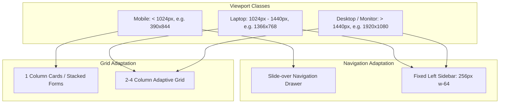

# Capital Real Estate Fleet Management System
## Deliverable 05: UI/UX Design System, Responsiveness & Accessibility Audit

---

### 1. Design System Philosophy: Cockpit-Inspired Enterprise Design

The visual design system of the **Capital Real Estate Fleet Management System** was custom-engineered to meet two primary demands:
1. **Corporate Brand Authority:** Integrating Capital Real Estate's corporate colors—a commanding flagship red (`brand-600`: `#dc2626`) and corporate emerald green (`brandGreen-600`: `#16a34a`)—balanced against deep slate and navy background tones.
2. **Cockpit Operational Clarity:** Inspired by automotive instruments and dispatch control rooms, the interface emphasizes high scannability, status-driven pill badges, high-contrast telemetry metrics, live route simulations, and minimal visual friction under stressful dispatch conditions.

---

### 2. Design Tokens & Styling Implementation

The design tokens are defined in [`apps/web/tailwind.config.js`](file:///home/yeabsira-hailegiorgis/Documents/Capital%20Fleet/apps/web/tailwind.config.js) and supplemented by custom utility classes in [`apps/web/src/index.css`](file:///home/yeabsira-hailegiorgis/Documents/Capital%20Fleet/apps/web/src/index.css):

#### 2.1 Color Palette System

| Token Family | Hex Value | Semantic Role in Application |
|:---|:---|:---|
| `brand-50` to `brand-500` | `#fef2f2` to `#ef4444` | Subtle tints, error highlights, and active red accents |
| `brand-600` | `#dc2626` | **Flagship Corporate Crimson Red:** Primary buttons, active sidebar selection, brand logo badge |
| `brand-700` to `brand-950` | `#b91c1c` to `#450a0a` | Hover states, dark mode borders, and deep red card backgrounds |
| `brandGreen-500` | `#22c55e` | Success states, active trip indicators, clearance confirmations |
| `brandGreen-600` | `#16a34a` | **Corporate Emerald Green:** Approved badges, gate pass clearance, vehicle available indicators |
| `navy-800` | `#1c1917` | Neutral surface borders in high-contrast views |
| `navy-900` | `#0f172a` | Primary dark-mode card background and table header fill |
| `navy-950` | `#090d16` | Main dark-mode background canvas behind workspace views |
| `status-available` | `#16a34a` | Fleet vehicle available for allocation |
| `status-assigned` | `#dc2626` | Vehicle allocated to active booking |
| `status-pending` | `#f59e0b` | Request awaiting logistics review (Amber warning) |
| `status-unavailable` | `#991b1b` | Vehicle in maintenance or scheduling conflict |
| `status-inactive` | `#64748b` | Decommissioned vehicle or inactive user account |

#### 2.2 Typography
* **Font Family:** Configured to modern geometric sans-serif: `Inter, system-ui, -apple-system, BlinkMacSystemFont, Segoe UI, Roboto, sans-serif`.
* **Hierarchy:**
  * Page Title: `text-2xl font-bold tracking-tight text-slate-900 dark:text-white`
  * Section Headers: `text-lg font-semibold text-slate-900 dark:text-white`
  * Sidebar Categories: `text-[11px] font-bold text-slate-400 dark:text-slate-500 uppercase tracking-wider`
  * Body Text: `text-sm text-slate-600 dark:text-slate-300`
  * Metadata / Captions: `text-xs text-slate-500 dark:text-slate-400`

#### 2.3 Depth, Elevation & Glow Effects
Tailwind is extended with custom elevation tokens engineered specifically for dark and bright environments:
* `boxShadow.subtle`: `0 1px 3px 0 rgba(0, 0, 0, 0.05)` (Clean delineation for light mode table rows)
* `boxShadow.card`: `0 4px 6px -1px rgba(0, 0, 0, 0.05)` (Container elevation)
* `boxShadow.floating`: `0 10px 25px -5px rgba(0, 0, 0, 0.08)` (Modal dialogs and dropdown menus)
* `boxShadow.glow-red`: `0 0 20px -3px rgba(220, 38, 38, 0.35)` (Primary action button hover aura)
* `boxShadow.glow-green`: `0 0 20px -3px rgba(22, 163, 74, 0.35)` (Gate clearance approval glow)

---

### 3. Dual-Theme Architecture (Dark & Light Modes)

The application features full dual-theme support managed through [`apps/web/src/context/ThemeContext.tsx`](file:///home/yeabsira-hailegiorgis/Documents/Capital%20Fleet/apps/web/src/context/ThemeContext.tsx):

#### 3.1 Implementation Mechanics
* **Theme Switching:** Triggered by a sun/moon icon toggle button in [`Navbar.tsx`](file:///home/yeabsira-hailegiorgis/Documents/Capital%20Fleet/apps/web/src/components/layout/Navbar.tsx).
* **DOM Mutation:** When `theme === 'dark'`, the context adds the `.dark` class to `document.documentElement` and sets `data-theme="dark"`. In light mode, it removes the class.
* **Storage Persistence:** Persisted in browser storage under `localStorage.getItem('capital_fleet_theme')`.
* **Cross-Tab Synchronization:** A native `window.addEventListener('storage', ...)` listener synchronizes theme changes across all open browser windows and tabs simultaneously without requiring page reloads.
* **System Preference Detection:** If no theme is saved in `localStorage`, the app automatically queries `window.matchMedia('(prefers-color-scheme: dark)')` to match the user's operating system preferences, defaulting to modern dark mode for high cockpit scannability.

---

### 4. Responsive Layout Behavior Across Viewports

The layout responsiveness is architected through a fluid container model combining Tailwind's responsive prefixes (`sm:`, `md:`, `lg:`, `xl:`, `2xl:`):



#### 4.1 Mobile Viewport (Phones, 390px to 640px)
* **Sidebar:** Automatically hides off-screen (`lg:hidden`). Replaced by a hamburger menu icon in the navbar. Clicking the hamburger opens a slide-over modal drawer with a darkened backdrop (`bg-slate-900/60 backdrop-blur-sm`).
* **Top Navbar:** The user name and department label collapse, leaving only the brand emblem, theme toggle, and notification bell to preserve horizontal touch targets.
* **Cards & Forms:** Multi-column layouts collapse to a single column (`grid-cols-1`). Touch targets for buttons are sized to at least `min-h-[44px]` to satisfy mobile ergonomics.
* **Tables:** Complex tables (such as `BookingsTable.tsx`) switch to horizontally scrollable viewports (`overflow-x-auto`) or mobile card stacks.

#### 4.2 Laptop Viewport (Standard University / Office Display: 1366x768)
* **Sidebar:** Fixed 256px (`w-64`) left-hand navigation pane with independent vertical scrolling (`overflow-y-auto`).
* **Main Viewport:** Occupies remaining horizontal space with fluid padding (`px-6 lg:px-8`).
* **Grid Distributions:** Dashboards render as a 2-column or 3-column grid (`grid-cols-1 md:grid-cols-2 lg:grid-cols-3`).

#### 4.3 Desktop / Dispatch Workstation (1920x1080 Full HD)
* **Capacity:** Dashboards expand to 4 columns (`xl:grid-cols-4`), maximizing information density for logistics dispatchers tracking multiple simultaneous fleet assignments.

---

### 5. Accessibility (a11y) & Usability Evaluation

An accessibility audit of the frontend source code identified several positive implementations and areas for future optimization:

#### 5.1 Verified Accessibility Features
* **Semantic HTML Elements:** The application uses `<header>`, `<nav>`, `<main>`, `<button type="button">`, `<input>`, and `<table>` elements with appropriate scoping.
* **ARIA Attributes:**
  * Toggle buttons feature explicit `aria-label` attributes (e.g., `aria-label="Toggle navigation menu"`, `aria-label="View notifications"` in `Navbar.tsx`).
  * Interactive menus contain `aria-expanded={isOpen}` to communicate dropdown states to assistive screen readers.
  * Modal dialogs feature `role="dialog"` and `aria-modal="true"`.
* **Keyboard Navigation & Esc Handlers:** Modal dialogs (such as `DigitalReceiptModal.tsx` and `Modal.tsx`) register global `keydown` event listeners for the `Escape` key to allow keyboard-only dismissal.
* **Scroll-Lock Management:** Active modal dialogs set `document.body.style.overflow = 'hidden'`, preventing accidental background viewport scrolling during modal interactions.

#### 5.2 Areas for Accessibility Enhancement
* **Form Inputs Label Association:** Some input fields in `BookingRequestForm.tsx` rely on visual header containers rather than explicit `<label htmlFor="...">` attributes. Adding programmatic `htmlFor` bindings is recommended.
* **Focus Trapping:** While modals listen to `Escape` key events, full Tab focus trapping (preventing tabbing outside active modals) is not yet implemented using a dedicated focus trap library.

---

### 6. Print Stylesheet Architecture (`@media print`)

To support corporate workflows that require physical paper documentation (such as Gate Clearance Vouchers and Audit Receipts), [`apps/web/src/index.css`](file:///home/yeabsira-hailegiorgis/Documents/Capital%20Fleet/apps/web/src/index.css) implements custom `@media print` rules:

```css
@media print {
  /* Hide non-printable UI chrome */
  header,
  nav,
  aside,
  button,
  .no-print,
  [data-no-print] {
    display: none !important;
  }

  /* Force clean white background and crisp black text */
  body,
  main,
  #root {
    background: #ffffff !important;
    color: #000000 !important;
    padding: 0 !important;
    margin: 0 !important;
  }

  /* Ensure high-resolution QR codes and barcodes print crisply */
  img,
  canvas {
    print-color-adjust: exact !important;
    -webkit-print-color-adjust: exact !important;
  }

  /* Page break rules for formal forms */
  .page-break-after {
    page-break-after: always;
  }
}
```

This print engine powers [`PrintableTransportFormModal.tsx`](file:///home/yeabsira-hailegiorgis/Documents/Capital%20Fleet/apps/web/src/features/bookings/PrintableTransportFormModal.tsx), ensuring that when a logistics officer presses "Print Transport Order", the resulting paper document contains crisp signature boxes, tabular itineraries, and high-density QR verification codes without any webpage navigation headers.

---

### 7. Screenshot & Visual Evidence Catalog

For the final academic internship report, the student should capture and embed high-resolution screenshots from the running application (`http://localhost:5173`). The following screenshot inventory is recommended:

| Image Reference | Page / Feature Name | Recommended Viewport | Operational Scenario to Capture |
|:---|:---|:---|:---|
| `fig_01_landing.png` | Corporate Landing Page | Desktop (1920x1080) | Hero section showing dynamic route simulation and corporate dispatch stats. |
| `fig_02_login.png` | Authentication Portal | Desktop (1920x1080) | Clean sign-in card with Capital Real Estate branding and demo credentials hint. |
| `fig_03_employee_dash.png` | Employee Dashboard | Laptop (1366x768) | Active bookings summary, quick book shortcut, and fleet radar widget. |
| `fig_04_booking_form.png` | Transport Request Form | Laptop (1366x768) | Dual-tab form showing 24h notice compliance badge and destination input. |
| `fig_05_logistics_dash.png` | Logistics Command Center | Desktop (1920x1080) | Pending requests counter, fleet utilization gauge, and quick-action row. |
| `fig_06_review_queue.png` | Review Requests Queue | Desktop (1920x1080) | Filterable request table showing Approve, Reject, and Assign buttons. |
| `fig_07_assign_modal.png` | Vehicle Assignment Modal | Laptop (1366x768) | Scored vehicle recommendations with conflict prevention badges visible. |
| `fig_08_driver_portal.png` | Driver Mission Dashboard | Mobile (390x844) | Chauffeur mission card showing Start Mission, Odometer input, and Arrival buttons. |
| `fig_09_gate_pass.png` | Public Gate Clearance Pass | Mobile (390x844) | Green security clearance card on `PublicVerificationPage` with live QR code. |
| `fig_10_digital_receipt.png`| Digital Receipt Modal | Desktop (1920x1080) | Cryptographic gate pass manifest with Level 'H' QR code and vehicle specs. |
| `fig_11_print_voucher.png` | Formal Printable Order | Desktop Print Preview | Formal paper requisition order with signature sign-off boxes. |
| `fig_12_admin_analytics.png`| Executive Analytics | Desktop (1920x1080) | Departmental trip consumption charts and fleet health status gauges. |
