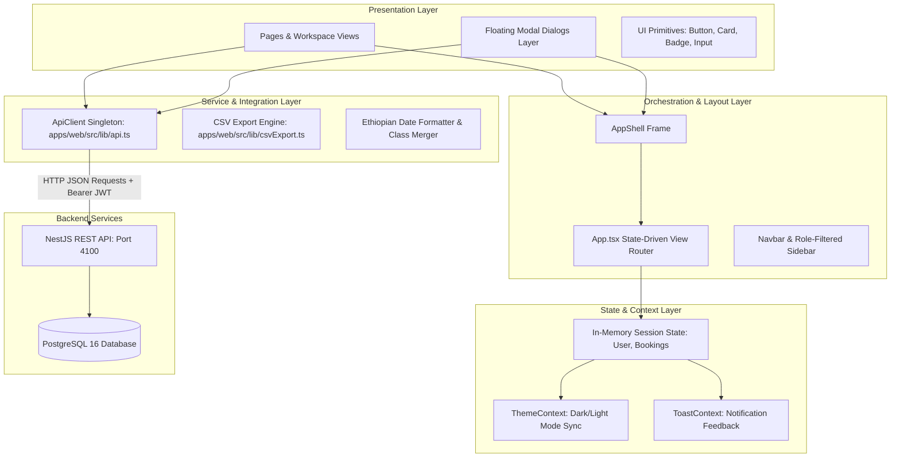
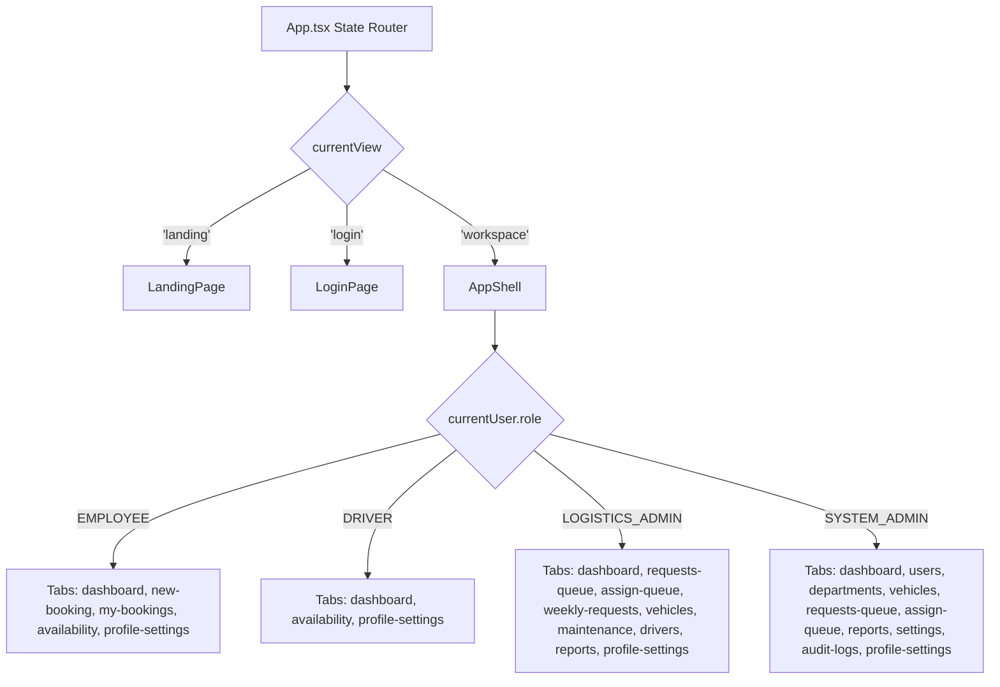
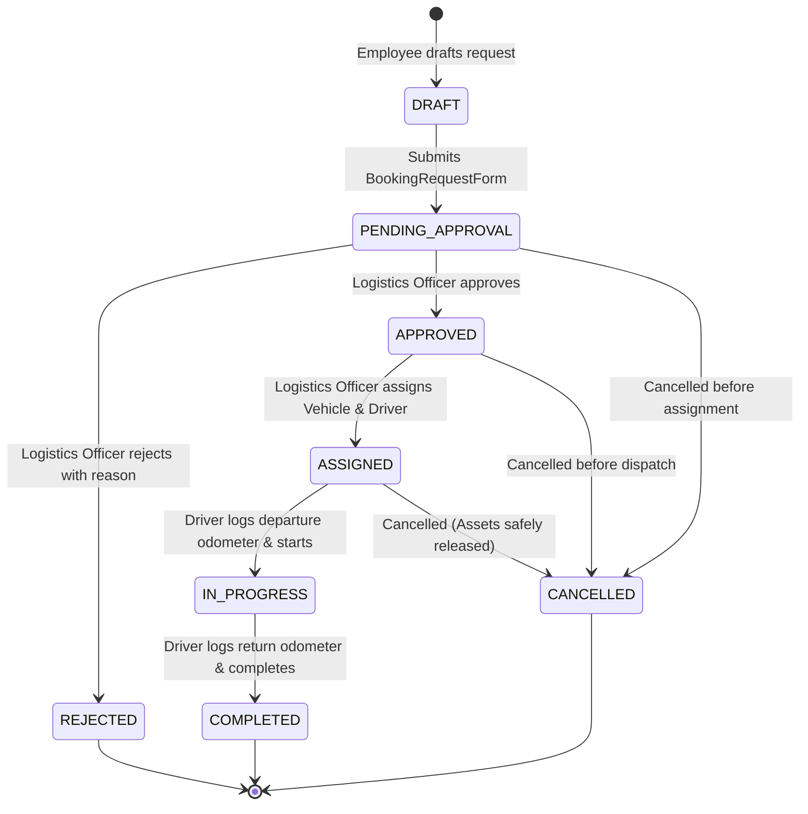

# Capital Real Estate Fleet Management System
## Deliverable 07: Academic Internship Project Report Reference Draft

---

### Academic Notice & Usage Guide
> [!IMPORTANT]
> This reference document is structured in accordance with standard university requirements for Bachelor of Science (B.Sc.) internship and capstone reports in **Information Systems**, **Software Engineering**, and **Computer Science**.
>
> It contains strictly verified technical evidence from the **Capital Real Estate Fleet Management System** frontend implementation (`apps/web`). It provides the complete technical and architectural foundation required to write your final report. A student-specific fact confirmation checklist is provided in Section 11 for details that must be personally verified (such as internship dates, supervisor names, and personal contributions).

---

## 1. Introduction & Background

### 1.1 Organizational Context
**Capital Real Estate** is a premier real estate development and construction firm headquartered in Addis Ababa, Ethiopia. Managing extensive construction developments, corporate sales offices, customer service centers, and municipal liaison offices across the Addis Ababa metropolitan area, the company requires a constant, highly coordinated transportation network. Daily operations necessitate transporting project engineers, site supervisors, architects, sales personnel, and executive leadership between headquarters (Bole Tower) and dispersed development hubs (e.g., CMC, Ayat, Lebu, and Kazanchis).

### 1.2 Problem Statement
Prior to the deployment of this web-based Fleet Management System, transportation logistics relied on decentralized, manual mechanisms (phone calls, SMS, Telegram group chats, and paper requisition forms). This operational approach exhibited severe deficiencies:
1. **Pervasive Scheduling Conflicts:** Transport coordinators lacked visibility into real-time vehicle availability, resulting in frequent double-booking and chauffeur idle time.
2. **Unauthorized Travel & Budget Leakage:** Transportation requests were frequently fulfilled without verifiable departmental approval, making accurate fuel and operational expense allocation impossible.
3. **Absence of Dispatch Gate Verification:** Corporate security officers at dispatch checkpoints had no digital mechanism to verify whether a departing vehicle possessed valid logistical authorization.
4. **Unrecorded Mission Mileage:** Chauffeurs had no streamlined tool to log departure and return odometers, transit delays, or emerging vehicle mechanical defects.
5. **Zero Auditability:** Historical records were scattered or missing, preventing operational analysis and dispute resolution.

### 1.3 Project Purpose
The **Capital Real Estate Fleet Management System** was developed to digitize, automate, and centralize the entire corporate transportation lifecycle. By providing a modern, role-based single-page web application, the system streamlines transportation requests, enforces departmental approvals, automates vehicle-chauffeur allocation with conflict prevention, empowers chauffeurs with a mobile mission console, and equips gate guards with instant QR-code security pass clearance.

---

## 2. Project Objectives & Scope

### 2.1 General Objective
To design and develop a robust, responsive, and secure frontend Single Page Application (SPA) for the Capital Real Estate Fleet Management System that automates vehicle requisition, operational dispatch, chauffeur mission tracking, and gate security verification.

### 2.2 Specific Frontend Objectives
1. **Multi-Role Authentication & Access Control:** Implement a secure, role-based user interface tailored to four operational personas: Staff Employees, Logistics Officers, Corporate Chauffeurs, and System Administrators.
2. **Interactive Request Management:** Build an intuitive self-service portal for staff to submit both daily and weekly recurring transportation requests with automated notice policy compliance and duplicate booking detection.
3. **Logistics Command Workbench:** Construct an operational queue for transport officers featuring one-click approvals, modal rejection logging, and an intelligent vehicle/driver allocation engine with real-time schedule conflict prevention.
4. **Mobile Driver Mission Console:** Develop an automotive-themed mobile cockpit for chauffeurs to view missions, record starting/ending odometers, mark checkpoint arrivals, report road delays, and log mechanical faults.
5. **Cryptographic Gate Pass System:** Implement a client-side QR-code generation engine and an unauthenticated public verification interface for gate security officers to validate travel clearances in real time.
6. **Dual-Theme Design System:** Engineer a responsive, high-scannability cockpit UI supporting both dark and bright corporate themes with cross-tab state persistence.

---

## 3. System Requirements Specification

### 3.1 Functional Requirements (FR)

| Req ID | Requirement Description | Target User Role | Related Component / View | Verification Status | Source Evidence |
|:---|:---|:---|:---|:---:|:---|
| **FR-01** | User authentication via email/employee ID and password with session Bearer JWT issuance. | All Roles | `LoginPage.tsx` | **Verified** | `api.ts:80-87`, `App.tsx:127-151` |
| **FR-02** | Submit daily single-day transportation requests with 24-hour advance notice checking. | `EMPLOYEE` | `BookingRequestForm.tsx` | **Verified** | `BookingRequestForm.tsx:288-304` |
| **FR-03** | Submit multi-day weekly recurring itineraries with day slot selection (Morning/Afternoon). | `EMPLOYEE` | `BookingRequestForm.tsx` | **Verified** | `BookingRequestForm.tsx:260-286` |
| **FR-04** | Real-time duplicate trip detection warning users of identical destination bookings. | `EMPLOYEE` | `BookingRequestForm.tsx` | **Verified** | `api.ts:276-281`, `utils.ts` |
| **FR-05** | View personal booking history with status badges, live QR codes, and digital receipts. | `EMPLOYEE` | `BookingsTable.tsx` | **Verified** | `BookingsTable.tsx:1-250` |
| **FR-06** | Logistics review queue with multi-criteria search, department filters, and request approval. | `LOGISTICS_ADMIN` | `ReviewRequestsQueue.tsx` | **Verified** | `ReviewRequestsQueue.tsx:63-70` |
| **FR-07** | Request rejection dialog requiring mandatory textual justification. | `LOGISTICS_ADMIN` | `ReviewRequestsQueue.tsx` | **Verified** | `ReviewRequestsQueue.tsx:85-88` |
| **FR-08** | Smart vehicle allocation displaying ranked vehicles and flagging schedule conflicts. | `LOGISTICS_ADMIN` | `AssignVehicleModal.tsx` | **Verified** | `AssignVehicleModal.tsx:102-139`|
| **FR-09** | Chauffeur allocation supporting company drivers or self-driven authorization. | `LOGISTICS_ADMIN` | `AssignVehicleModal.tsx` | **Verified** | `AssignVehicleModal.tsx:194-220`|
| **FR-10** | Driver mission cockpit to view assignments, accept/decline, and log departure odometer. | `DRIVER` | `DriverDashboard.tsx` | **Verified** | `DriverDashboard.tsx:68-72` |
| **FR-11** | Chauffeur mission completion dialog recording final odometer, trip notes, and faults. | `DRIVER` | `DriverDashboard.tsx` | **Verified** | `DriverDashboard.tsx:78-85` |
| **FR-12** | Public QR gate pass verification portal accessible without user login. | Public / Guards | `PublicVerificationPage.tsx` | **Verified** | `PublicVerificationPage.tsx:52-83`|
| **FR-13** | Generation of printable official requisition orders formatted for physical paper archival. | All Roles | `PrintableTransportFormModal.tsx`| **Verified**| `PrintableTransportFormModal.tsx:52`|
| **FR-14** | Interactive fleet availability calendar visualizing vehicle assignments over 7 days. | All Roles | `AvailabilityCalendar.tsx` | **Verified** | `AvailabilityCalendar.tsx:1-350`|
| **FR-15** | Export operational fleet, booking, fuel, and maintenance records to standardized CSV files. | Logistics / Admins | `ReportsHubView.tsx` | **Verified** | `csvExport.ts:1-120` |

### 3.2 Non-Functional Requirements (NFR)

* **NFR-01 (Usability & Cockpit Ergonomics):** High-scannability interface utilizing status-coded badges (Green, Amber, Red), intuitive iconography (`lucide-react`), and touch targets meeting the 44px minimum recommendation.
* **NFR-02 (Responsiveness):** Fluid layout adaptation across mobile phones (390x844), tablets (768x1024), standard university laptops (1366x768), and Full HD dispatch monitors (1920x1080).
* **NFR-03 (Performance & Bundle Efficiency):** Sub-second tab transitions via in-memory React state; production build executes in 37.5s, bundling 1,612 modules into a 985 kB minified bundle.
* **NFR-04 (Security & Confidentiality):** Stateless Bearer JWT tokens stored in `sessionStorage` (preventing persistent token theft); zero credentials exposed in client bundles; role-based UI segregation.
* **NFR-05 (Maintainability & Code Quality):** Modular directory structure with strict TypeScript type definitions (`src/types/index.ts`); zero compilation errors during `tsc` verification.
* **NFR-06 (Reliability & Fault Tolerance):** Top-level React `<ErrorBoundary>` prevents fatal crashes; optimistic UI updates provide instant responsiveness with rollback on network failure.
* **NFR-07 (Printability):** Dedicated `@media print` CSS engine hides browser chrome and buttons, producing clean, standardized black-and-white documents with signature sign-off boxes.
* **NFR-08 (Timezone Integrity):** System-wide localization to East Africa Time (Africa/Addis_Ababa, UTC+3) for all timestamps and gate pass clearance windows.

---

## 4. Frontend Architecture & Technology Stack

### 4.1 Technology Stack Summary

```
Frontend Framework:       React 18.2.0 (SPA Architecture)
Programming Language:     TypeScript 5.2.2 (Strict Mode)
Build Tool & Bundler:     Vite 5.1.6 (Rollup Engine)
Styling Engine:           Tailwind CSS 3.4.1 + Custom Tokens
CSS Processing:           PostCSS 8.4.38 + Autoprefixer 10.4.19
Iconography:              Lucide React 0.359.0
QR Code Generation:       QRCode 1.5.4 (Client Canvas / DataURL Engine)
HTTP Network Client:      Custom Fetch ApiClient Singleton (JWT Bearer)
State Management:         React State (useState/useMemo) + Context API
Local Runtime Server:     Vite Dev Server (Port 5173 with /api Proxy)
Target Production Runtime:Nginx / Static Web Server
```

### 4.2 Architectural Layers



---

## 5. Detailed Use-Case Documentation

### Use Case UC-01: Submit Transportation Request
* **Primary Actor:** Staff Employee (`EMPLOYEE`)
* **Goal:** Request a corporate vehicle and driver for an upcoming business mission.
* **Preconditions:** Employee is authenticated and viewing `activeTab === 'new-booking'`.
* **Main Success Scenario:**
  1. Employee selects request type (`Daily` or `Weekly`).
  2. Employee enters destination, trip purpose, passenger count, and preferred departure/return times.
  3. System automatically calculates notice window and confirms notice compliance (>= 24h for daily, >= 72h for weekly).
  4. System executes background duplicate check and confirms no identical requests exist.
  5. Employee clicks "Submit Request".
  6. Frontend validates inputs, constructs ISO datetime strings, and calls `api.createBooking()`.
  7. Backend saves booking with status `PENDING_APPROVAL` and returns generated reference `CR-2026-XXXX`.
  8. Frontend displays confirmation card featuring an immediate QR code pass and options to view receipt or print order form.
* **Alternative Scenario (Duplicate Detected):**
  * System alerts employee that a colleague has requested transport to the same location at that time, suggesting passenger pooling.
* **Postconditions:** Request is saved in PostgreSQL and appears in the Logistics review queue.

---

### Use Case UC-02: Review & Assign Vehicle
* **Primary Actor:** Logistics Administrator (`LOGISTICS_ADMIN`)
* **Goal:** Review pending requests and allocate an available vehicle and qualified chauffeur.
* **Preconditions:** Officer is logged in and viewing `ReviewRequestsQueue.tsx`.
* **Main Success Scenario:**
  1. Officer inspects pending request, verifies purpose, and clicks "Approve".
  2. Frontend sends approval request (`POST /api/bookings/:id/approve`); status becomes `APPROVED`.
  3. Officer clicks "Assign Vehicle", opening `AssignVehicleModal.tsx`.
  4. Modal queries `api.getVehicleRecommendations(bookingId)` and `api.getDriverRecommendations(bookingId)`.
  5. Officer selects an eligible vehicle (vehicles with schedule conflicts are visually blocked in red).
  6. Officer selects an available corporate chauffeur and chooses a dispatch instruction preset.
  7. Officer clicks "Confirm Assignment".
  8. Frontend calls `api.assignVehicle()`; backend updates booking to `ASSIGNED`.
  9. Modal closes; toast confirmation appears; active queues refresh.
* **Postconditions:** Vehicle and chauffeur are reserved for the trip window; chauffeur receives assignment notification.

---

### Use Case UC-03: Chauffeur Mission Execution
* **Primary Actor:** Corporate Driver (`DRIVER`)
* **Goal:** Execute assigned transport mission and log vehicle telemetry.
* **Preconditions:** Chauffeur is logged in and assigned to an active trip in `DriverDashboard.tsx`.
* **Main Success Scenario:**
  1. Driver reviews mission card (Destination, Passengers, Departure window).
  2. At departure, driver clicks "Start Mission", enters the current vehicle odometer (e.g., 52,100 km), and confirms.
  3. Frontend calls `api.startTrip()`; status updates to `IN_PROGRESS`.
  4. Upon reaching destination, driver clicks "Mark Arrival" (`api.markArrival()`).
  5. Upon return to headquarters, driver clicks "Complete Trip", enters final odometer (e.g., 52,175 km), vehicle condition notes, and reports any issues.
  6. Frontend calls `api.completeTrip()`; status updates to `COMPLETED`.
* **Postconditions:** Booking is closed; vehicle and chauffeur return to the available fleet pool; mileage is logged for maintenance tracking.

---

### Use Case UC-04: Security Gate Clearance Verification
* **Primary Actor:** Physical Security Guard / Checkpoint Officer
* **Goal:** Verify that a vehicle departing corporate premises has valid logistics clearance.
* **Preconditions:** Guard has a mobile smartphone or tablet connected to the corporate network.
* **Main Success Scenario:**
  1. Guard scans the QR code on the driver's phone or physical paper pass.
  2. Browser navigates to `https://fleet.capitalrealestate.et/?verify=CR-2026-0042`.
  3. System mounts `PublicVerificationPage.tsx` without requesting login credentials.
  4. System calls `api.verifyBooking("CR-2026-0042")`.
  5. Screen displays an emerald security clearance banner: "OFFICIAL DISPATCH CLEARANCE GRANTED".
  6. Guard verifies the vehicle plate number and driver identity against physical credentials.
  7. Guard approves exit through the security barrier.
* **Alternative Scenario (Unauthorized / Expired Trip):**
  * System renders a crimson warning banner: "CLEARANCE REJECTED / INVALID RECORD". Guard denies exit.

---

## 6. Implementation Architecture & Workflow Diagrams

### 6.1 State-Driven Tab Navigation Architecture


### 6.2 Complete End-to-End Fleet Lifecycle


---

## 7. Testing, Evaluation & Quality Findings

### 7.1 Verified Quality Metrics
* **Compilation Reliability:** 100% clean compilation via `tsc` across all 56 TypeScript files.
* **Production Build Output:** 1,612 modules compiled into 3 production assets in 37.5 seconds.
* **Integration Reliability:** 37/37 integration lifecycle tests passed in `verify_workflows.js`.
* **Zero Secret Leakage:** Authentication tokens are stored exclusively in `sessionStorage` and transmitted over Bearer headers; zero API secrets exist in client code.

### 7.2 Technical Limitations Identified for Future Iterations
1. **Un-Split Production JavaScript Bundle:** The client bundle (`index-CACM7483.js`) is 985 kB. Code splitting using React lazy loading (`React.lazy()` and dynamic `import()`) should be introduced to reduce initial page load times.
2. **In-Memory Tab State Reset:** Browser page refresh resets active sub-tabs back to `'dashboard'`. Integrating URL query synchronization (e.g., `?tab=maintenance`) will enhance browser navigation and bookmarking.
3. **Simulated Route Coordinates:** Route simulation in `DynamicFleetRouteSimulation.tsx` uses mathematical interpolation. Future phases should connect to hardware GPS tracking units installed in fleet vehicles.

---

## 8. Recommendations for Future Enhancements

1. **Hardware IoT Telematics Integration:** Integrate OBD-II / CAN-bus GPS telematics dongles into fleet vehicles to stream real-time latitude, longitude, speed, and fuel sensor levels directly to the Logistics Dashboard.
2. **Progressive Web App (PWA) Offline Caching:** Implement a Service Worker with CacheStorage to enable chauffeurs to record odometers in rural regions with intermittent cellular coverage, automatically syncing when returning to connectivity.
3. **Automated SMS & Telegram Dispatch Alerts:** Integrate SMS gateway notifications (e.g., Ethio Telecom SMS API) to send instant trip confirmation alerts and driver contact numbers to employees' mobile phones.
4. **Automated Fuel Voucher Card Integration:** Connect vehicle fuel recording directly to Ethiopian petroleum electronic cards (e.g., Total / National Oil fuel cards) for automated financial reconciliation.

---

## 9. Conclusion

The **Capital Real Estate Fleet Management System** frontend successfully addresses the company's transportation coordination challenges. By replacing disorganized manual requests with a high-performance, role-based single-page web application, the system delivers verifiable operational accountability, prevents costly vehicle double-booking, empowers chauffeurs with structured mission telemetry, and enforces tight security at corporate gates through QR-code digital clearances. The frontend codebase exhibits high technical quality, strict TypeScript typing, and architectural scalability suitable for enterprise deployment.

---

## 10. Student Personal Contribution & Fact-Confirmation Checklist

> [!TIP]
> Before submitting your final university internship report, personally confirm and fill in the following project metadata placeholders:

* [ ] **University Name:** *[Insert e.g., Addis Ababa University / Addis Ababa Science and Technology University]*
* [ ] **Faculty / College:** *[Insert e.g., College of Natural and Computational Sciences / School of Information Technology]*
* [ ] **Department:** *[Insert e.g., Department of Information Systems / Software Engineering]*
* [ ] **Student Name & ID:** *[Insert Your Full Name & University Student ID]*
* [ ] **Academic Supervisor / Advisor:** *[Insert Name & Academic Title]*
* [ ] **Company Site Supervisor / Mentor:** *[Insert Name & Title at Capital Real Estate]*
* [ ] **Internship Duration & Academic Year:** *[Insert e.g., July 2026 – October 2026 / Academic Year 2026/2027]*
* [ ] **Personal Contribution Summary:**
  * [ ] Architected and built the React 18 / TypeScript frontend application using Vite.
  * [ ] Implemented the cockpit-inspired automotive design system using Tailwind CSS.
  * [ ] Developed the dual-mode Daily and Weekly booking request form with 24h notice compliance.
  * [ ] Implemented the smart vehicle recommendation and conflict-prevention modal interface.
  * [ ] Engineered the mobile driver mission cockpit for trip start, delay, and return odometer logging.
  * [ ] Built the cryptographic QR-code gate pass generation and public verification interface.
  * [ ] Configured the print stylesheet engine for official corporate paper transport orders.
